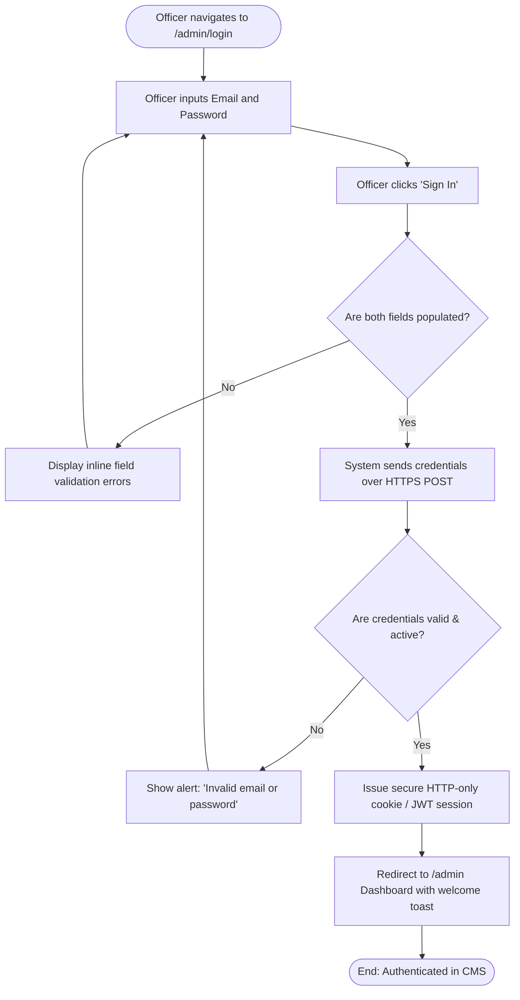
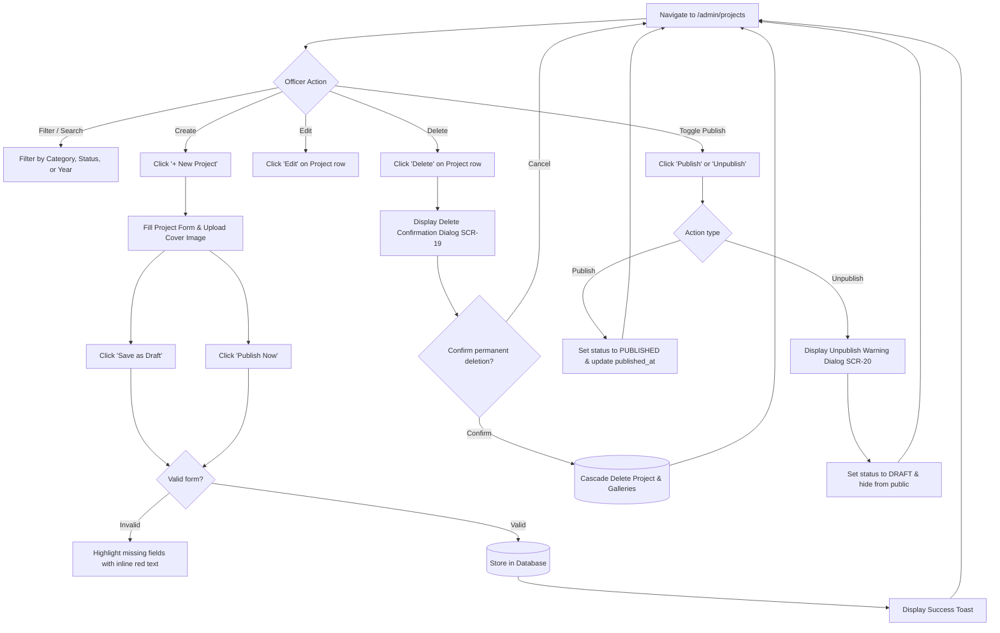
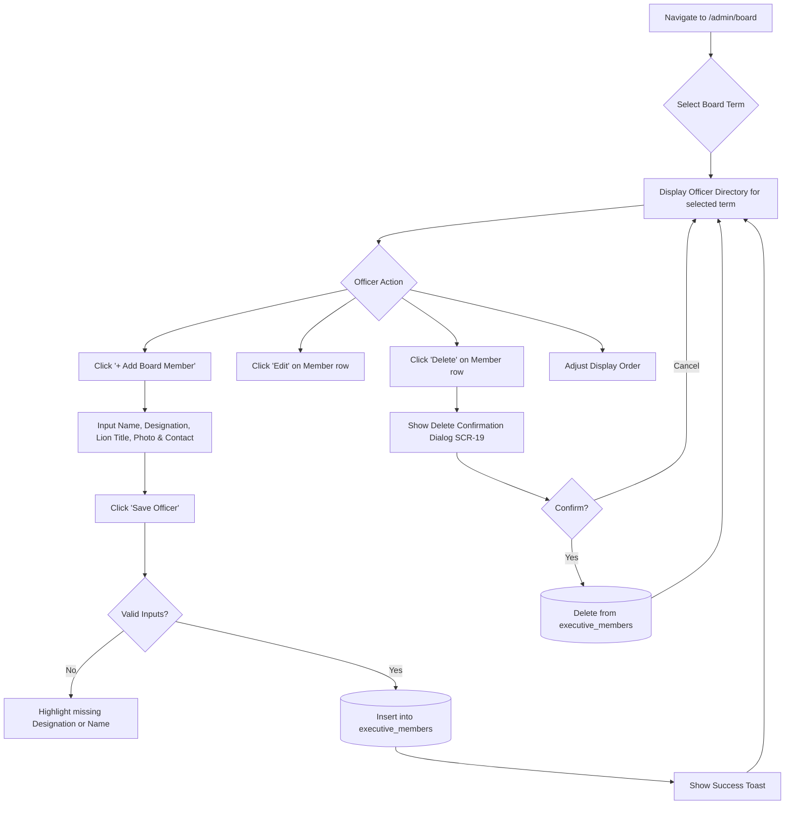

# CMS Admin User Workflows & Interaction Flows

**Project:** Lions Club of Balangoda Web Portal & Content Management System  
**Course:** IS5109 Community Project (Group 14)  
**Target Users:** Non-technical Club Officers (e.g., Club Secretary, President, Project Chairs)  
**Requirement Mapping:** FR-06 (Content Management CRUD) & FR-07 (Submissions & Inquiries Management)  
**Reviewer:** Jinos  
**Author:** Ahmed Ahnaf (Branch: `ahmed_ahnaf`)  

---

## 1. Overview & User Roles

The CMS is tailored specifically for club officers who do not possess technical or programming experience. Interactions emphasize clear feedback, intuitive forms, safety dialogs for destructive actions, and seamless recovery from mistakes.

Two primary roles operate within the administrative portal:
- **`ADMIN` (Full Administrator):** Can manage all content (Projects, News, Board), curate media, review and export submissions, and manage officer user accounts.
- **`EDITOR` (Content Officer):** Can create, edit, and draft projects, news, and board records, but cannot manage users or alter system-wide settings.

---

## 2. Authentication & Session Workflows

### WF-AUTH-01: Admin Login & Session Initialization


1. **Starting Point:** Unauthenticated user navigates to `/admin` or `/admin/login`.
2. **User Action:** Enters registered club officer email address and password into the respective fields and clicks the primary **"Sign In"** button.
3. **System Response:** The login component disables the submit button, displays an accessible loading spinner, and sends the credentials over encrypted HTTPS (`SEC-01`, `SEC-04`).
4. **Decision Points:**
   - *Are email or password missing?* → Client-side form check intercepts before network dispatch.
   - *Are credentials recognized in the database and account active?* → Authenticates and sets session cookie.
   - *Are credentials incorrect?* → Rejection with generic warning to prevent username enumeration.
5. **Validation:** Non-empty check on both fields; basic email format validation (`^[^\s@]+@[^\s@]+\.[^\s@]+$`).
6. **Success State:** Session initialized; user redirected to `/admin` (Dashboard); top-right navigation displays officer's full name and role badge (`ADMIN` or `EDITOR`).
7. **Error State:** Red alert banner displayed: *"Invalid email or password. Please verify your credentials and try again."* Form remains populated with the email; password field is cleared; focus returns to password input.
8. **Cancellation or Recovery Path:** If password is forgotten, officer clicks *"Forgot password?"* link to initiate email-based reset workflow (`Docs/project-proposal.md` M01 / Section 3.2).

---

### WF-AUTH-02: Session Expiration & Automatic Timeout
1. **Starting Point:** Officer is inactive on any CMS admin page for over 60 minutes.
2. **User Action:** Officer attempts any action (e.g., clicking a link or submitting a form).
3. **System Response:** API returns HTTP `401 Unauthorized`. Frontend preserves any unsubmitted form drafts in local browser cache where feasible.
4. **Decision Points:** Officer must re-authenticate to continue.
5. **Validation:** Validation of JWT expiration timestamp.
6. **Success State:** After re-entering credentials on `/admin/login?redirect=...`, officer is restored directly to their previous working screen without losing context.
7. **Error State:** If session was forcefully revoked by a super-admin, redirect to login with notice: *"Your session has ended. Please log in again."*
8. **Cancellation or Recovery Path:** Officer can choose to return to the public home portal via a "Back to Public Website" button.

---

### WF-AUTH-03: Admin Logout
1. **Starting Point:** Officer is authenticated and located on any `/admin/*` page.
2. **User Action:** Clicks the officer profile dropdown in the top-right header and selects **"Sign Out"**.
3. **System Response:** Browser terminates session tokens, deletes authentication cookies, clears cached administrative queries, and redirects to `/admin/login`.
4. **Decision Points:** No confirmation modal needed for logout; immediate safe exit.
5. **Validation:** Server marks session token invalid.
6. **Success State:** Landing on `/admin/login` showing a green toast notification: *"You have been securely signed out."*
7. **Error State:** Network failure on logout still clears local cookies and forces redirect to login screen.
8. **Cancellation or Recovery Path:** Officer can log back in immediately.

---

## 3. Dashboard Navigation & Summary Workflow

### WF-DASH-01: Access Dashboard & Module Quick Shortcuts
1. **Starting Point:** Officer successfully authenticates into the CMS.
2. **User Action:** Views the primary dashboard page at `/admin`.
3. **System Response:** System calculates and displays 4 real-time summary indicator cards:
   - **Active Projects:** Total published and draft service activities.
   - **Published News:** Total active news posts and pinned announcements.
   - **Pending Volunteer Applications:** Count of volunteer signups with `PENDING` status.
   - **Unresolved Inquiries:** Count of general/sponsorship contact requests with `NEW` status.
4. **Decision Points:** Officer chooses an administrative task based on indicators:
   - Click **"+ New Project"** shortcut → Navigates directly to `WF-PROJ-02`.
   - Click **"+ New Announcement"** shortcut → Navigates directly to `WF-NEWS-02`.
   - Click **"Review Volunteer Submissions"** → Navigates to `WF-SUB-01` with status filter set to `PENDING`.
   - Click **"Upload Media"** → Opens `WF-MEDIA-01` modal.
5. **Validation:** Read-only aggregate counts from `projects`, `news_announcements`, `volunteer_applications`, and `general_inquiries`.
6. **Success State:** Dashboard displays current statistics and a table of the 5 most recent activities/submissions.
7. **Error State:** If an API endpoint fails, card displays an inline retry button: *"Could not load metric. [Retry]"*.
8. **Cancellation or Recovery Path:** Left-hand navigation sidebar remains permanently visible for direct navigation to any module.

---

## 4. Projects Management Workflows (FR-06)



### WF-PROJ-01: View & Filter Project List
1. **Starting Point:** Officer is on the CMS Dashboard or clicks **"Projects"** in the left sidebar (`/admin/projects`).
2. **User Action:** Views paginated table (10 items per page). Optionally enters a keyword into the search bar, selects a Category dropdown (`Healthcare`, `Education`, `Environment`, `Poverty Relief`), or filters by Status (`All`, `Published`, `Draft`, `Archived`).
3. **System Response:** System filters rows dynamically without a full-page reload, displaying Project Title, Category badge, Event Date, Cover Image thumbnail, Status badge, and Action buttons (`View`, `Edit`, `Delete`).
4. **Decision Points:**
   - If results match criteria → Table renders matching records.
   - If no records match → Displays friendly empty state: *"No projects found matching your search. Try adjusting your filters or create a new project."*
5. **Validation:** Search input sanitized against SQL injection and XSS (`SEC-02`, `SEC-03`).
6. **Success State:** Desired project located with clear metadata and status.
7. **Error State:** If network error occurs during fetch, shows banner: *"Failed to load projects. [Click to Retry]"*.
8. **Cancellation or Recovery Path:** Officer clicks **"Reset Filters"** to restore default list view.

---

### WF-PROJ-02: Create Community Service Project
1. **Starting Point:** Officer clicks the primary **"+ New Project"** button on the Projects list screen.
2. **User Action:**
   - Enters **Project Title** (e.g., *"Free Vision Screening Camp 2026"*). System automatically generates the URL Slug (e.g., `free-vision-screening-camp-2026`).
   - Selects **Service Pillar / Category** from dropdown (`HEALTHCARE`, `EDUCATION`, `ENVIRONMENT`, `POVERTY_RELIEF`, `OTHER`).
   - Selects **Event Date** from date-picker and inputs **Location** (e.g., *"Balangoda Town Hall"*).
   - Selects or uploads a **Cover Image** using the integrated media selector.
   - Enters a concise **Project Summary** (1–2 sentences for cards/previews).
   - Enters full project narrative and impact report using the **WYSIWYG Rich-Text Editor** (supports bold, lists, headings).
   - Optionally attaches up to 20 gallery photos.
   - Clicks either **"Save as Draft"** or **"Publish Now"**.
3. **System Response:** 
   - Disables submit buttons and shows progress indicator.
   - Submits payload to `POST /api/admin/projects`.
   - Validates data and ensures unique slug.
   - Stores project in `projects` table; associates gallery photos in `project_gallery`.
4. **Decision Points:**
   - *Save as Draft:* `status = 'DRAFT'`. Project is saved in CMS but hidden from public portal.
   - *Publish Now:* `status = 'PUBLISHED'`, `published_at = CURRENT_TIMESTAMP`. Project is immediately visible on the public `/projects` directory.
5. **Validation:** 
   - Title: Required, 5–150 characters.
   - Category: Required valid enum.
   - Event Date: Required, valid date.
   - Location: Required, 2–100 characters.
   - Cover Image: Required for publishing; optional for draft.
   - Summary: Required, 10–300 characters.
6. **Success State:** Redirects to `/admin/projects` with a green toast notification: *"Project 'Free Vision Screening Camp 2026' was successfully created and [published/saved as draft]!"*
7. **Error State:** 
   - If required fields are blank, highlights offending inputs with red borders and displays inline messages: *"Please provide a project title."*
   - If slug collides with an existing project, system auto-appends an incremented suffix (e.g., `-1`) or flags the field.
8. **Cancellation or Recovery Path:** Officer clicks **"Cancel"**. If unsaved text exists, browser triggers a prompt: *"You have unsaved changes. Are you sure you want to discard them?"*

---

### WF-PROJ-03: View Project Details
1. **Starting Point:** Officer clicks the **"View"** action icon or project title on the projects table.
2. **User Action:** Inspects the read-only overview at `/admin/projects/[id]`.
3. **System Response:** Displays all project attributes, publication status, creator officer name, created date, last updated timestamp, cover photo preview, formatted narrative, and the curated photo gallery.
4. **Decision Points:**
   - Click **"Edit Project"** → Navigates to `WF-PROJ-04`.
   - Click **"View on Public Site"** (if published) → Opens public URL (`/projects/[slug]`) in a new browser tab.
   - Click **"Back to Projects"** → Returns to `/admin/projects`.
5. **Validation:** Verifies project ID exists in database; returns 404 if invalid.
6. **Success State:** Complete record displayed cleanly with responsive layout.
7. **Error State:** If ID is invalid, shows message: *"Project not found. It may have been deleted by another officer."*
8. **Cancellation or Recovery Path:** Click breadcrumb to return to project list.

---

### WF-PROJ-04: Edit Project
1. **Starting Point:** Officer clicks **"Edit"** from either the project list or project detail view.
2. **User Action:** Modifies text fields, replaces the cover image, adds/removes gallery photos, or changes category. Clicks **"Save Changes"**.
3. **System Response:** Validates inputs, saves updates to `projects`, sets `updated_at = CURRENT_TIMESTAMP`, invalidates public cache for this slug, and redirects to project details.
4. **Decision Points:**
   - Officer can keep current publication status or toggle between Draft and Published.
5. **Validation:** Same rules as creation (`WF-PROJ-02`).
6. **Success State:** Green confirmation toast: *"Project updates saved successfully."*
7. **Error State:** Form displays inline errors for any invalid modifications. Previous values remain preserved.
8. **Cancellation or Recovery Path:** Officer clicks **"Cancel"**; changes discarded; returns to detail screen.

---

### WF-PROJ-05: Delete Project
1. **Starting Point:** Officer clicks the red **"Delete"** trashcan icon in the project row or detail page.
2. **User Action:** System renders the **Delete Confirmation Modal** (`SCR-19`). Officer reads the explicit consequence: *"Are you sure you want to delete '[Project Title]'? This will permanently remove the project and all 8 associated gallery images from the database. This action cannot be undone."*
3. **System Response:** Officer must click the red button **"Yes, Delete Project"** to execute.
4. **Decision Points:**
   - Click **"Cancel"** → Closes modal; no database alterations occur.
   - Click **"Yes, Delete Project"** → Calls `DELETE /api/admin/projects/[id]`.
5. **Validation:** User must have active administrative session.
6. **Success State:** Database executes cascade deletion of project and linked `project_gallery` records. Modal closes; row is removed from table with fade animation; green toast displayed: *"Project '[Project Title]' has been permanently deleted."*
7. **Error State:** If deletion fails (e.g., database constraint or connection drop), error toast appears: *"Failed to delete project. Please try again or contact support."*
8. **Cancellation or Recovery Path:** Clicking "Cancel", pressing `Esc`, or clicking outside the modal safely dismisses the prompt without deleting anything.

---

### WF-PROJ-06 & WF-PROJ-07: Publish & Unpublish Project
- **Publish Workflow:** 
  1. Officer clicks **"Publish"** on a draft project.
  2. System checks that all publish-readiness rules are met (title, cover image, summary, event date).
  3. System updates `status = 'PUBLISHED'` and `published_at = CURRENT_TIMESTAMP`.
  4. Success toast: *"Project is now live on the public website!"* Status badge turns green (`PUBLISHED`).
- **Unpublish Workflow:**
  1. Officer clicks **"Unpublish"** on a live project.
  2. System displays **Unpublish Confirmation Dialog** (`SCR-20`) clearly stating: *"This will unpublish the project and immediately hide it from public visitors. All text, images, and settings will remain safely saved in the CMS and can be re-published at any time."*
  3. Officer clicks **"Yes, Unpublish"**.
  4. System updates `status = 'DRAFT'`.
  5. Success toast: *"Project has been unpublished and moved to Drafts."* Status badge turns amber (`DRAFT`).

---

## 5. News & Announcements Workflows (FR-06)

### WF-NEWS-01: View News & Announcements List
1. **Starting Point:** Officer clicks **"News & Announcements"** in sidebar (`/admin/news`).
2. **User Action:** Views table displaying Title, Type (`News`, `Announcement`, `Press Release`), Pin Status (📌 icon), Expiration Date, Status (`Draft`, `Published`), and Actions (`View`, `Edit`, `Delete`).
3. **System Response:** Displays filtered list; provides filter pills: *"All"*, *"News"*, *"Announcements"*, *"Drafts"*.
4. **Decision Points:** Quick action to toggle Pin or navigate to Editor.
5. **Validation:** Standard query sanitization.
6. **Success State:** News items rendered clearly.
7. **Error State:** Fetch error displays retry banner.
8. **Cancellation or Recovery Path:** Clear filters.

---

### WF-NEWS-02: Create News or Announcement
1. **Starting Point:** Officer clicks **"+ New Article"** on News List screen.
2. **User Action:**
   - Enters **Article Title** (e.g., *"Annual Lions Mega Health Camp Announced"*).
   - Selects **News Type** from dropdown (`NEWS`, `ANNOUNCEMENT`, `PRESS_RELEASE`).
   - Uploads or selects **Cover Image**.
   - Enters **Article Content** via WYSIWYG editor.
   - Toggles **"Pin to Top of Homepage"** checkbox if this is an urgent bulletin.
   - If pinned, optionally selects **Expiration Date** (after which the article automatically unpins).
   - Clicks **"Publish Now"** or **"Save as Draft"**.
3. **System Response:** Validates inputs, saves to `news_announcements` table, and indexes for homepage query.
4. **Decision Points:**
   - If `is_pinned = TRUE`, system ensures this article is given priority in the public news carousel.
5. **Validation:** Title required (5–200 chars); Content required; Type required. Expiration date, if entered, must be in the future.
6. **Success State:** Redirects to news list with toast: *"News article published successfully!"*
7. **Error State:** Inline validation errors highlight invalid dates or missing text.
8. **Cancellation or Recovery Path:** Cancel button prompts for confirmation if text was entered.

---

### WF-NEWS-03 to WF-NEWS-07: News Edit, Delete, Pin & Unpublish
- **Edit (`WF-NEWS-04`):** Modify content, change pin status, adjust expiration date, update in database.
- **Delete (`WF-NEWS-05`):** Requires confirmation via `SCR-19`. Permanently deletes article record.
- **Pin Toggle (`WF-NEWS-06`):** One-click toggle directly in table or form to feature an urgent announcement on the homepage banner.
- **Unpublish (`WF-NEWS-07`):** Reverts published article to `DRAFT` status via `SCR-20`, hiding it from public view without data loss.

---

## 6. Executive Board Records Workflows (FR-06)



### WF-BOARD-01: View Executive Board Directory
1. **Starting Point:** Officer clicks **"Executive Board"** in CMS sidebar (`/admin/board`).
2. **User Action:** Views the current active term's directory (e.g., *"Term 2026/2027 (Current)"*). Can select past terms from a dropdown to view historic rosters.
3. **System Response:** Renders table sorted by `display_order` ascending (President first, followed by Secretary, Treasurer, Vice Presidents, Directors). Columns include: Photo thumbnail, Full Name, Lion Title (e.g., *"Lion Prof."*), Designation, Contact Email, Contact Phone, and Display Order.
4. **Decision Points:**
   - Officer can switch term or add an officer to the selected term.
5. **Validation:** Term ID exists in `board_terms`.
6. **Success State:** Directory loaded in correct hierarchical order.
7. **Error State:** Network error shows retry prompt.
8. **Cancellation or Recovery Path:** Switch back to current term.

---

### WF-BOARD-02: Create Executive Board Member Record
1. **Starting Point:** Officer clicks **"+ Add Board Member"** at `/admin/board`.
2. **User Action:**
   - Selects **Lionistic Term** (defaults to currently selected term).
   - Enters **Full Name** (e.g., *"T. Sanjeewa Prasad Jayaweera"*).
   - Enters **Lion Title** (e.g., *"Lion Prof."* or *"Lion Dr."*).
   - Enters **Club Designation** (e.g., *"Club President"*, *"Club Secretary"*).
   - Enters **Display Order** (e.g., `1` for President, `2` for Secretary, `3` for Treasurer).
   - Enters **Official Contact Email** and **Phone Number** (publicly visible for club inquiries).
   - Uploads high-resolution **Profile Photo**.
   - Enters concise **Short Biography / Message** (optional).
   - Clicks **"Save Officer"**.
3. **System Response:** Validates inputs, saves to `executive_members`, refreshes public board roster cache.
4. **Decision Points:** Officer can add another member immediately via *"Save & Add Another"* button.
5. **Validation:** Full Name (2–150 chars, required); Designation (2–100 chars, required); Term (required); Display Order (integer ≥ 0); Email (valid format if provided).
6. **Success State:** Redirects to roster with toast: *"Officer '[Full Name]' was successfully added to the [Term] Board."*
7. **Error State:** Form highlights missing designation or duplicate display sequence warning.
8. **Cancellation or Recovery Path:** Click "Cancel" to return to board roster without saving.

---

### WF-BOARD-03 to WF-BOARD-05: Board Edit & Delete
- **Edit (`WF-BOARD-04`):** Update designation, phone number, photo, or re-order position in roster.
- **Delete (`WF-BOARD-05`):** Displays Delete Confirmation Modal (`SCR-19`). Clarifies: *"Are you sure you want to remove '[Officer Name]' from the [Term] Executive Board? This will remove their profile from the public directory."* Confirmation safely deletes the record.

---

## 7. Media Asset Upload & Gallery Workflows (FR-06)

### WF-MEDIA-01: Select, Validate & Upload Image
```mermaid
flowchart TD
    Trigger[Officer clicks 'Upload Photo' or drops file] --> ClientCheck{Client-side File Validation}
    ClientCheck -- Size > 5MB --> ErrorSize[Show Error: 'File exceeds 5MB limit']
    ClientCheck -- Invalid MIME --> ErrorType[Show Error: 'Only JPG, PNG, WebP supported']
    ClientCheck -- Valid --> ShowProgress[Display Upload Progress Bar 0-100%]
    ShowProgress --> Cloudinary[Upload to Cloudinary Asset Storage via secure API]
    Cloudinary -- Network Failure --> ErrorUpload[Show Error: 'Upload interrupted. [Retry]']
    Cloudinary -- Success --> SaveAsset[(Save asset record in media_assets)]
    SaveAsset --> Preview[Display thumbnail preview with Alt Text input]
    Preview --> Attach[Asset available for Cover Image or Gallery]
```

1. **Starting Point:** Officer is in the Project/News editor or opens the standalone Media Library modal (`SCR-15`).
2. **User Action:** Drags and drops an image file or clicks **"Browse Files"** from local computer.
3. **System Response:** Client-side validator immediately checks file properties before sending bytes to server:
   - **Allowed formats:** `image/jpeg`, `image/png`, `image/webp`.
   - **Maximum file size:** `5.0 MB`.
4. **Decision Points:**
   - If valid → Upload progress bar displays real-time progress (0% to 100%).
   - If invalid format or oversized → File rejected instantly with clear explanation.
5. **Validation:** 
   - Strict MIME check (`image/jpeg`, `image/png`, `image/webp`).
   - File size check (`bytes <= 5,242,880`).
   - Filename sanitization.
6. **Success State:** Image uploaded to Cloudinary; metadata (URL, dimensions, format, file size) written to `media_assets` table; thumbnail renders with green checkmark; input field appears to provide **Alt Text / Caption** for accessibility (`NFR-02`).
7. **Error State:** If connection breaks during upload, system displays red retry badge: *"Upload failed due to network interruption. [Click to Retry]"*.
8. **Cancellation or Recovery Path:** Officer can click the "X" button on any uploading/uploaded thumbnail to cancel and remove it.

---

## 8. Submissions & Inquiries Workflows (FR-07)

```mermaid
flowchart TD
    SubNav[Navigate to /admin/submissions] --> TabSelect{Select Submissions Tab}
    TabSelect -->|Volunteers| VolList[View Volunteer Applications Table]
    TabSelect -->|Inquiries| InqList[View General & Sponsor Inquiries Table]

    VolList --> VolAction{Action}
    VolAction --> ViewVol[Click 'Review' on Volunteer Row]
    VolAction --> ExportVol[Click 'Export Volunteers (CSV)']

    ViewVol --> VolDetail[Inspect Application Details SCR-17]
    VolDetail --> UpdateVolStatus[Update Status: PENDING / REVIEWED / ACCEPTED]
    UpdateVolStatus --> SaveVolNotes[Add internal interview / screening notes]
    SaveVolNotes --> VolSaveDB[(Save updates to volunteer_applications)]
    VolSaveDB --> VolToast[Show Status Updated Toast]

    ExportVol --> GenVolCSV[Filter by date/status & compile CSV]
    GenVolCSV --> DownloadVol[Browser downloads 'volunteer_applications_YYYYMMDD.csv']

    InqList --> InqAction{Action}
    InqAction --> ViewInq[Click 'Read' on Inquiry Row]
    InqAction --> ExportInq[Click 'Export Inquiries (CSV)']

    ViewInq --> InqDetail[Inspect Inquiry Message SCR-18]
    InqDetail --> UpdateInqStatus[Update Status: NEW / IN_PROGRESS / RESOLVED]
    UpdateInqStatus --> InqSaveDB[(Save updates to general_inquiries)]
    InqSaveDB --> InqToast[Show Status Updated Toast]

    ExportInq --> GenInqCSV[Compile CSV with UTF-8 BOM]
    GenInqCSV --> DownloadInq[Browser downloads 'inquiries_YYYYMMDD.csv']
```

### WF-SUB-01: View & Filter Volunteer Applications
1. **Starting Point:** Officer clicks **"Submissions"** in sidebar and selects the **"Volunteer Signups"** tab (`/admin/submissions?tab=volunteers`).
2. **User Action:** Views paginated list showing: Submission Date, Applicant Full Name, Email, Phone Number, City, Areas of Interest/Skills, and Status Badge (`PENDING`, `REVIEWED`, `INTERVIEWED`, `ACCEPTED`, `REJECTED`).
3. **System Response:** Filters table dynamically by status pill or date range. Highlights new unreviewed applications with a distinct blue badge.
4. **Decision Points:**
   - Click applicant row → Opens detailed view `WF-SUB-02`.
   - Click "Export Volunteers (CSV)" → Executes `WF-SUB-04`.
5. **Validation:** Sanitized search query.
6. **Success State:** Records displayed with formatted local dates (e.g., *"05 Nov 2026, 10:15 AM"*).
7. **Error State:** Empty state shows: *"No volunteer applications found for this filter."*
8. **Cancellation or Recovery Path:** Reset filter to "All".

---

### WF-SUB-02 & WF-SUB-03: Review Volunteer Details & Update Status
1. **Starting Point:** Officer clicks on an applicant from the volunteers table.
2. **User Action:** Opens detailed review drawer / screen (`SCR-17`). Reviews applicant's full details:
   - Personal details (Full Name, NIC/Passport, Date of Birth, Gender, Address/City).
   - Contact info (Email with 1-click mailto link, Phone number with 1-click tel link).
   - Skills, interests, and availability days/hours.
   - Motivation statement ("Why I want to join Lions Club Balangoda").
   - Reviews administrative timeline (`submitted_at`, `updated_at`, `reviewed_by`).
   - Changes **Application Status** dropdown (e.g., from `PENDING` to `REVIEWED` or `ACCEPTED`).
   - Enters **Internal Administrative Notes** (e.g., *"Contacted via phone on Nov 5; interested in diabetes camp committee"*).
   - Clicks **"Save Status & Notes"**.
3. **System Response:** Updates `volunteer_applications` in database; records current officer UUID in `reviewed_by`.
4. **Decision Points:** Officer can copy contact info to clipboard with a single click.
5. **Validation:** Notes optional but limited to 1,000 characters; status must be a valid enum.
6. **Success State:** Green toast: *"Application status updated to [ACCEPTED]."* Table badge updates immediately.
7. **Error State:** Database save error triggers alert: *"Could not update status. Please try again."*
8. **Cancellation or Recovery Path:** Officer clicks "Back to Volunteers" without saving if no changes needed.

---

### WF-SUB-04: Export Volunteer Applications to CSV
1. **Starting Point:** Officer is on the Volunteer Signups tab (`/admin/submissions?tab=volunteers`).
2. **User Action:** Clicks the **"Export Volunteers (CSV)"** button.
3. **System Response:** 
   - System prompts an export confirmation popover: *"Export all 45 volunteer applications currently filtered?"*
   - Officer confirms **"Download CSV"**.
   - Server queries filtered records, escapes special spreadsheet formula characters (`=`, `+`, `-`, `@`) to prevent CSV injection vulnerabilities, builds RFC 4180 compliant CSV stream with UTF-8 Byte Order Mark (BOM) for native Excel support.
   - Browser initiates file download: `lions_volunteers_YYYYMMDD_HHMM.csv`.
4. **Decision Points:**
   - Officer can export currently filtered subset or entire historical database.
5. **Validation:** Verifies officer has `ADMIN` or authorized `EDITOR` permissions.
6. **Success State:** Clean CSV file downloaded containing: `Application ID`, `Full Name`, `Email`, `Phone`, `City`, `Skills & Interests`, `Availability`, `Status`, `Submitted At`, `Internal Notes`.
7. **Error State:** If no records match, shows warning toast: *"No records available to export for the selected filter."*
8. **Cancellation or Recovery Path:** Click "Cancel" in popover closes prompt.

---

### WF-SUB-05 to WF-SUB-08: General & Sponsorship Inquiries Management
1. **View Inquiries (`WF-SUB-05`):** Access `/admin/submissions?tab=inquiries`. Views inquiries categorized as `GENERAL`, `SPONSORSHIP`, `PARTNERSHIP`, `DONATION`, or `FEEDBACK`.
2. **Read Inquiry (`WF-SUB-06`):** Opens inquiry detail screen (`SCR-18`). Displays Sender Name, Email, Phone, Organization Name (for sponsors), Subject, and full Message text.
3. **Update Status (`WF-SUB-07`):** Officer updates status from `NEW` to `IN_PROGRESS` or `RESOLVED`, or flags as `SPAM`. Records internal resolution note (e.g., *"President replied via official club email with sponsorship package on Nov 5"*).
4. **Export Inquiries (`WF-SUB-08`):** Generates `lions_inquiries_YYYYMMDD.csv` for executive committee meetings.
