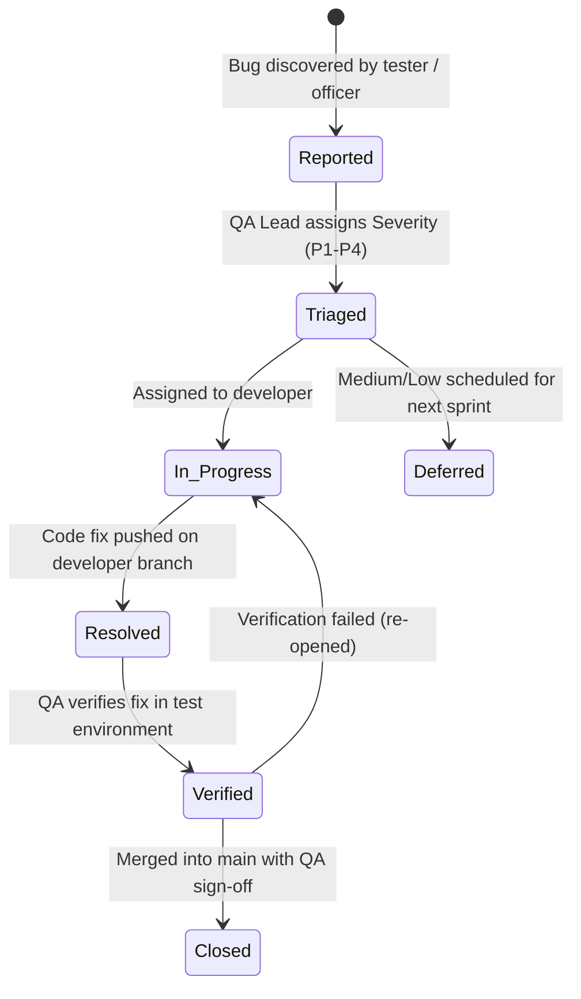

# Bug Severity Scale & Release Gate Policy

**Project:** Lions Club of Balangoda Web Portal & Content Management System  
**Course:** IS5109 – Information Systems Project for Community (Group 14)  
**Assigned QA Reviewer:** M.N.M Nafris (22FIS0545)  
**Author:** Ahmed Ahnaf (Branch: `ahmed_ahnaf`)  
**Status:** Agreed Standard for Sprint 1 & Project Lifecycle  

---

## 1. Executive Purpose

To ensure high reliability, data protection, and a smooth user experience for both the general community and non-technical club officers, the development team has agreed upon a standardized **Four-Tier Bug Severity Scale**.

This scale establishes unambiguous definitions, concrete examples from the Lions Club portal stack, explicit triage rules, and the strict **Release Gate Criteria** that dictate whether a build is permitted to be deployed to staging or production.

---

## 2. Bug Severity Definitions

```
+-----------------------------------------------------------------------------+
| TIER 1: CRITICAL (P1)   --> BLOCKS RELEASE UNCONDITIONALLY                   |
+-----------------------------------------------------------------------------+
| TIER 2: HIGH (P2)       --> BLOCKS RELEASE (Exception requires QA Lead sign-off) |
+-----------------------------------------------------------------------------+
| TIER 3: MEDIUM (P3)     --> DOES NOT BLOCK RELEASE (Deferred to next sprint) |
+-----------------------------------------------------------------------------+
| TIER 4: LOW (P4)        --> DOES NOT BLOCK RELEASE (Backlog cosmetic polish) |
+-----------------------------------------------------------------------------+
```

### 2.1 Critical Severity (Tier 1 / P1 - Blocker)
- **Definition:** A defect that causes complete system unavailability, unrecoverable data loss or corruption, a critical security vulnerability (OWASP Top 10), authentication bypass, or completely breaks a primary user journey with **no available workaround**.
- **User Impact:** Club officers cannot log into the CMS; public visitors see crash pages (HTTP 500 / blank screen); volunteer or donor personal information is exposed.
- **Project Examples:**
  - Database connection pool exhaustion crashes the server on project search (`SEC-01`, `NFR-03`).
  - Deleting a project accidentally purges unrelated executive board records due to incorrect SQL cascade rules.
  - Admin login allows unauthorized access without checking the bcrypt password hash (`SEC-04`).
  - Cross-Site Scripting (XSS) in public search allows malicious JavaScript execution in visitors' browsers (`SEC-03`).
  - Public `/projects` route crashes with runtime unhandled exception on initial render.
- **Release Gate Impact:** **BLOCKS RELEASE UNCONDITIONALLY.**  
  *No release to staging or production is permitted with even a single open Critical defect. All team work halts to resolve Critical defects.*
- **Resolution Target (SLA):** Fix and verify within **4 hours** of identification.

---

### 2.2 High Severity (Tier 2 / P2 - Major)
- **Definition:** A defect that impairs core functionality, produces incorrect business logic results, or causes severe visual/usability collapse on supported devices, where a workaround is either nonexistent, excessively difficult, or unacceptable for end users.
- **User Impact:** Visitors cannot find projects because category filtering displays wrong items; club officers cannot upload photos due to unexplained silent upload failure; layout completely breaks on mobile phones (360px viewport).
- **Project Examples:**
  - Selecting "Healthcare" filter displays "Education" projects or omits valid published projects (`FR-02`).
  - Draft projects (`status = 'DRAFT'`) appear on the public website, leaking unapproved club announcements.
  - Media uploader fails silently when an officer uploads a valid 3.5 MB JPEG photo (`FR-06`, `WF-MEDIA-01`).
  - Navigation menu or search bar overlaps and becomes un-clickable on mobile viewports below 400px (`NFR-02`).
  - Volunteer application form submits successfully but fails to record contact phone numbers in the database (`FR-05`, `FR-07`).
- **Release Gate Impact:** **BLOCKS RELEASE BY DEFAULT.**  
  *May only be bypassed for non-production internal milestones if an explicit written waiver is approved by QA Lead Nafris and Reviewer Jinos, with a documented mitigation plan scheduled for immediate resolution.*
- **Resolution Target (SLA):** Fix and verify within **24 hours**.

---

### 2.3 Medium Severity (Tier 3 / P3 - Moderate)
- **Definition:** A defect that affects non-critical functions, secondary workflows, or presents a minor usability friction where a reasonable and straightforward workaround exists. The primary user journey remains intact.
- **User Impact:** Minor confusion or inconvenience; users can easily achieve their goal through an alternative button or action.
- **Project Examples:**
  - Search keyword filtering is case-sensitive instead of case-insensitive (e.g., searching "vision" misses "Vision Camp").
  - Date picker on project create form does not default to today's date, requiring officers to select it manually.
  - Form validation message uses developer jargon rather than friendly club officer phrasing, but still prevents invalid input.
  - Project card summary text does not truncate cleanly at 3 lines, resulting in slightly uneven card heights on tablet viewports.
  - CSV export file omits submission timestamps but contains all personal contact fields (`FR-07`).
- **Release Gate Impact:** **DOES NOT BLOCK RELEASE.**  
  *Release may proceed with documented Medium defects. Defects are logged in Jira and scheduled for the subsequent sprint.*
- **Resolution Target (SLA):** Resolved within the current or next sprint cycle (within 1 week).

---

### 2.4 Low Severity (Tier 4 / P4 - Minor / Cosmetic)
- **Definition:** A minor cosmetic, visual, or stylistic defect that has zero impact on functionality, data integrity, or user workflow.
- **User Impact:** Purely aesthetic imperfection noticed only upon close inspection.
- **Project Examples:**
  - A typo in non-critical body copy (e.g., *"communty"* instead of *"community"* in a footer description).
  - Hover state transition duration on category filter pill is 100ms instead of the design token 200ms.
  - Slight 4px margin discrepancy on desktop screens above 1440px width.
  - Empty state icon is missing a subtle drop shadow.
- **Release Gate Impact:** **DOES NOT BLOCK RELEASE.**  
  *Release proceeds normally. Low severity items are tracked in the product backlog and resolved during polish phases.*
- **Resolution Target (SLA):** Addressed as time permits during UI polish or sprint cleanup.

---

## 3. Release Gate (Quality Gate) Policy Matrix

Before any milestone build or pull request is merged into `main` or deployed, the QA Lead (Nafris) must verify the following **Quality Gate Checklist**:

| Quality Gate Criterion | Threshold Requirement | Enforcement Action |
|---|---|---|
| **Critical (P1) Open Bugs** | **Must be 0 (Zero)** | **Deploy Blocked** if > 0 |
| **High (P2) Open Bugs** | **Must be 0 (Zero)** | **Deploy Blocked** (Waiver exception requires QA Lead sign-off) |
| **Medium (P3) Open Bugs** | Maximum 3 documented | Release permitted with Jira tickets tracked |
| **Low (P4) Open Bugs** | No hard limit | Backlogged |
| **Automated Test Suite Pass Rate** | **100% of P1 & P2 automated tests must pass** | Pull request cannot be merged |
| **Regression Status** | Zero regressions in previously working slices | Pull request blocked |
| **Security Verification** | Parameterized queries verified (`SEC-02`), XSS sanitized (`SEC-03`) | Mandatory sign-off |

---

## 4. Defect Lifecycle Workflow

Every defect identified during testing must progress through this formal lifecycle:



1. **Reported:** Bug logged using standard Jira format with reproduction steps and device/browser details.
2. **Triaged:** QA Lead (Nafris) verifies reproduction, assigns severity (`Critical`, `High`, `Medium`, `Low`), and confirms release blocker status.
3. **In Progress:** Developer implements fix on their dedicated personal branch (e.g., `ahmed_ahnaf`).
4. **Resolved:** Fix submitted via Pull Request referencing the Jira bug key (`[LBW-XX]`).
5. **Verified:** QA Lead re-runs the specific failing test case and runs regression checks.
6. **Closed:** Defect closed and archived in release notes.
