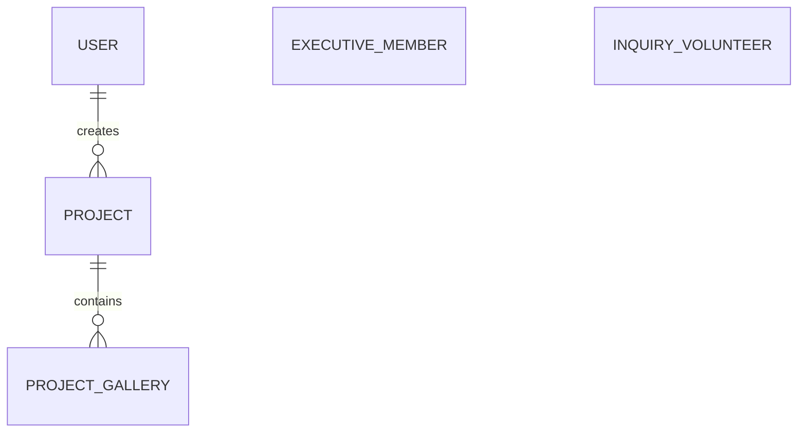
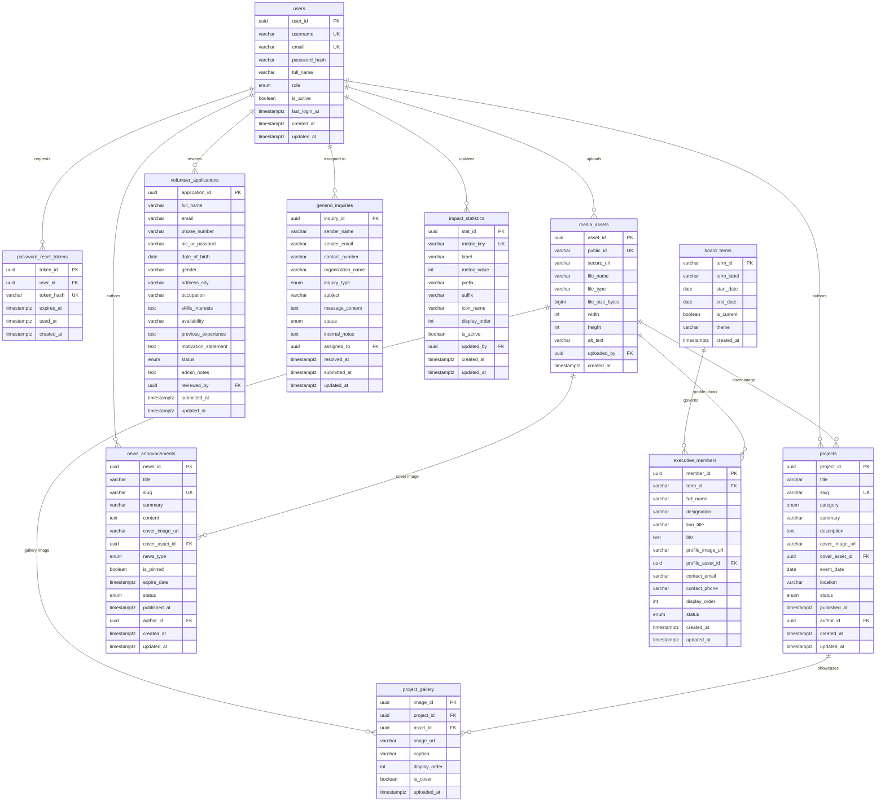

# Database Schema & Core Data Relationships Specification
## Lions Club of Balangoda Web Portal & Content Management System

- **Project:** IS5109 – IS Project for Community (Group 14)
- **Institution:** Department of Computing & Information Systems, Sabaragamuwa University of Sri Lanka
- **Client:** Lions Club of Balangoda (Lions Clubs International District 306)
- **Author:** M.P Asmad Sahee (22FIS0543)
- **Reviewers:** M.N.M Nafris (22FIS0545), M.H.M Yoosuf (22FIS0519)
- **Priority:** Highest | Blocks all database-backed work (Sprint 1 / Sprint 2 Milestone)

---

## 1. Executive Summary

This document establishes the comprehensive relational database schema and migration architecture for the Lions Club of Balangoda Web Portal and Content Management System (CMS). 

The initial database design presented in Section 1.6 of the approved project proposal modeled basic entities (`USER`, `PROJECT`, `PROJECT_GALLERY`, `EXECUTIVE_MEMBER`, `INQUIRY_VOLUNTEER`), but left key functional and architectural gaps unresolved. This specification resolves every identified omission, models all public and administrative use cases, provides an updated Entity-Relationship (ER) diagram, details a production migration plan, and presents parameterized query templates for all system operations.

---

## 2. Comparison: Proposal ER vs. Extended ER

### 2.1 Original Proposal ER (Baseline)

The approved proposal's ER diagram contained five entities with minimal relationships:
- `USER` (1 — N) `PROJECT` ("creates / manages")
- `PROJECT` (1 — N) `PROJECT_GALLERY` ("contains")
- `EXECUTIVE_MEMBER` (Standalone, unlinked)
- `INQUIRY_VOLUNTEER` (Standalone, overloaded table)



**Identified Shortcomings in Proposal ER:**
1. **Missing `NEWS_ANNOUNCEMENT`:** Required by Class Diagram (`NewsAnnouncement extends ContentItem`), UC09, and FR-06, but omitted from the ER.
2. **Unstructured Board Filtering:** `EXECUTIVE_MEMBER.term_year` was an unvalidated string, risking data drift (e.g., `'2024-2025'` vs `'2024/25'`) and lacking term lifecycle metadata (such as `is_current` and presidential theme).
3. **Overloaded Inquiries & Volunteers:** `INQUIRY_VOLUNTEER` conflated general contact inquiries with structured volunteer registrations, causing nullable columns and conflicting workflows.
4. **Lack of Media Asset Management:** No centralized tracking for Cloudinary/S3 assets, file metadata, or image reuse.
5. **Missing Security & Recovery Infrastructure:** No password reset token table (`PASSWORD_RESET_TOKEN`) for M01 recovery, and undefined `role` values on `USER`.
6. **Missing Homepage Counters:** No storage mechanism for dynamic impact statistics (FR-01, Section 1.13).
7. **Duplicate Attribute:** Duplicate `location` attribute listed in proposal `PROJECT` entity.

---

### 2.2 Extended Production ER Diagram

The extended ER diagram introduces full normalization, explicit integrity constraints, foreign key cascades, role-based authorization, and publication workflows.



---

## 3. Detailed Data Dictionary

### 3.1 `users`
Stores administrative staff and content editors authorized to access the CMS (Module M01).

| Field | Type | Nullable | Constraints / Defaults | Description |
|---|---|---|---|---|
| `user_id` | UUID | No | PRIMARY KEY, `gen_random_uuid()` | Unique user identifier |
| `username` | VARCHAR(50) | No | UNIQUE | CMS login handle |
| `email` | VARCHAR(255) | No | UNIQUE | Officer email address (used for recovery) |
| `password_hash` | VARCHAR(255) | No | | Bcrypt hash (work factor ≥ 12) or Argon2id |
| `full_name` | VARCHAR(100) | No | | Official display name |
| `role` | ENUM | No | `'ADMIN'`, `'EDITOR'`; Default `'EDITOR'` | Role-based permission tier |
| `is_active` | BOOLEAN | No | Default `TRUE` | Account state flag |
| `last_login_at` | TIMESTAMPTZ | Yes | NULL | Timestamp of most recent login |
| `created_at` | TIMESTAMPTZ | No | `CURRENT_TIMESTAMP` | Account creation audit stamp |
| `updated_at` | TIMESTAMPTZ | No | `CURRENT_TIMESTAMP` | Last profile update audit stamp |

**Indexes:**
- `uq_users_username` on `username` (UNIQUE)
- `uq_users_email` on `email` (UNIQUE)
- `idx_users_role` on `role`
- `idx_users_is_active` on `is_active`

---

### 3.2 `password_reset_tokens`
Stores cryptographically secure one-time password reset tokens (M01 / SEC-04).

| Field | Type | Nullable | Constraints / Defaults | Description |
|---|---|---|---|---|
| `token_id` | UUID | No | PRIMARY KEY, `gen_random_uuid()` | Unique token identifier |
| `user_id` | UUID | No | FK → `users(user_id)` ON DELETE CASCADE | Target user account |
| `token_hash` | VARCHAR(255) | No | UNIQUE | SHA-256 hash of plaintext secret sent via email |
| `expires_at` | TIMESTAMPTZ | No | | Token validity window (e.g., 60 minutes) |
| `used_at` | TIMESTAMPTZ | Yes | NULL | Timestamp when successfully consumed |
| `created_at` | TIMESTAMPTZ | No | `CURRENT_TIMESTAMP` | Token generation timestamp |

**Indexes:**
- `uq_pwd_reset_token_hash` on `token_hash` (UNIQUE)
- `idx_pwd_reset_user` on `(user_id, expires_at)`
- `idx_pwd_reset_lookup` on `(token_hash, expires_at, used_at)`

---

### 3.3 `media_assets`
Maintains records of all uploaded binary media hosted on Cloudinary / S3 CDN.

| Field | Type | Nullable | Constraints / Defaults | Description |
|---|---|---|---|---|
| `asset_id` | UUID | No | PRIMARY KEY, `gen_random_uuid()` | Unique asset identifier |
| `public_id` | VARCHAR(255) | No | UNIQUE | Cloudinary public identifier or S3 key |
| `secure_url` | VARCHAR(1024) | No | | CDN HTTPS access URL |
| `file_name` | VARCHAR(255) | Yes | NULL | Original uploaded filename |
| `file_type` | VARCHAR(100) | No | | MIME type (e.g., `'image/jpeg'`, `'image/webp'`) |
| `file_size_bytes` | BIGINT | Yes | NULL | Binary size in bytes |
| `width` | INTEGER | Yes | NULL | Pixel width (for aspect ratio calculation) |
| `height` | INTEGER | Yes | NULL | Pixel height |
| `alt_text` | VARCHAR(255) | Yes | NULL | Default WCAG 2.1 AA accessibility description |
| `uploaded_by` | UUID | Yes | FK → `users(user_id)` ON DELETE SET NULL | Officer who uploaded the file |
| `created_at` | TIMESTAMPTZ | No | `CURRENT_TIMESTAMP` | Asset creation timestamp |

**Indexes:**
- `uq_media_assets_public_id` on `public_id` (UNIQUE)
- `idx_media_assets_created` on `created_at DESC`

---

### 3.4 `board_terms`
Represents official Lionistic administrative years (July 1 to June 30) for directory archiving (FR-04, UC04).

| Field | Type | Nullable | Constraints / Defaults | Description |
|---|---|---|---|---|
| `term_id` | VARCHAR(20) | No | PRIMARY KEY | Standard Lionistic year format, e.g. `'2024-2025'` |
| `term_label` | VARCHAR(100) | No | | Formatted label, e.g. `'Lionistic Year 2024/2025'` |
| `start_date` | DATE | No | | Term commencement date (e.g., `2024-07-01`) |
| `end_date` | DATE | No | CHECK (`start_date < end_date`) | Term conclusion date (e.g., `2025-06-30`) |
| `is_current` | BOOLEAN | No | Default `FALSE` | Active executive administration indicator |
| `theme` | VARCHAR(255) | Yes | NULL | International or Club presidential theme |
| `created_at` | TIMESTAMPTZ | No | `CURRENT_TIMESTAMP` | Record creation timestamp |

**Indexes:**
- `idx_board_terms_current` on `is_current`
- `idx_board_terms_dates` on `start_date DESC`

---

### 3.5 `executive_members`
Stores executive committee board members and designations for a specific Lionistic year (FR-04, UC04, UC11).

| Field | Type | Nullable | Constraints / Defaults | Description |
|---|---|---|---|---|
| `member_id` | UUID | No | PRIMARY KEY, `gen_random_uuid()` | Member term assignment identifier |
| `term_id` | VARCHAR(20) | No | FK → `board_terms(term_id)` ON DELETE RESTRICT | Associated Lionistic administrative term |
| `full_name` | VARCHAR(150) | No | | Full name of the officer |
| `designation` | VARCHAR(100) | No | | Official position (e.g. `'Club President'`) |
| `lion_title` | VARCHAR(50) | Yes | NULL | Lions honorific (e.g. `'Lion Prof.'`, `'Lion'`) |
| `bio` | TEXT | Yes | NULL | Profile biography and service background |
| `profile_image_url`| VARCHAR(1024) | Yes | NULL | Resolved CDN image URL |
| `profile_asset_id` | UUID | Yes | FK → `media_assets(asset_id)` ON DELETE SET NULL | Reference to managed media asset |
| `contact_email` | VARCHAR(255) | Yes | NULL | Official club contact email |
| `contact_phone` | VARCHAR(50) | Yes | NULL | Contact telephone number |
| `display_order` | INTEGER | No | Default `0` | Order of precedence (President = 1, etc.) |
| `status` | ENUM | No | `'ACTIVE'`, `'INACTIVE'`; Default `'ACTIVE'` | Roster active status |
| `created_at` | TIMESTAMPTZ | No | `CURRENT_TIMESTAMP` | Audit creation stamp |
| `updated_at` | TIMESTAMPTZ | No | `CURRENT_TIMESTAMP` | Audit update stamp |

**Indexes:**
- `idx_exec_members_term_order` on `(term_id, display_order ASC)`
- `idx_exec_members_status` on `status`

---

### 3.6 `projects`
Core community humanitarian project showcase and archive (FR-01, FR-02, UC02, UC08).

| Field | Type | Nullable | Constraints / Defaults | Description |
|---|---|---|---|---|
| `project_id` | UUID | No | PRIMARY KEY, `gen_random_uuid()` | Unique project identifier |
| `title` | VARCHAR(255) | No | | Headline title of the project |
| `slug` | VARCHAR(255) | No | UNIQUE | URL-safe slug for clean routing (`/projects/[slug]`) |
| `category` | ENUM | No | `'HEALTHCARE'`, `'EDUCATION'`, `'ENVIRONMENT'`, `'POVERTY_RELIEF'`, `'OTHER'` | Service pillar classification |
| `summary` | VARCHAR(500) | No | | Concise brief for project cards & SEO meta tags |
| `description` | TEXT | No | | Comprehensive WYSIWYG HTML / Markdown body |
| `cover_image_url` | VARCHAR(1024) | Yes | NULL | Direct CDN URL for card and hero banner |
| `cover_asset_id` | UUID | Yes | FK → `media_assets(asset_id)` ON DELETE SET NULL | Reference to managed media asset |
| `event_date` | DATE | No | | Date of field execution |
| `location` | VARCHAR(255) | No | | Geographic location (e.g. `'Town Hall, Balangoda'`) |
| `status` | ENUM | No | `'DRAFT'`, `'PUBLISHED'`, `'ARCHIVED'`; Default `'DRAFT'` | Editorial publication status |
| `published_at` | TIMESTAMPTZ | Yes | NULL | Release timestamp for public visibility |
| `author_id` | UUID | No | FK → `users(user_id)` ON DELETE RESTRICT | CMS user who authored the entry |
| `created_at` | TIMESTAMPTZ | No | `CURRENT_TIMESTAMP` | Audit record timestamp |
| `updated_at` | TIMESTAMPTZ | No | `CURRENT_TIMESTAMP` | Last updated timestamp |

**Indexes:**
- `uq_projects_slug` on `slug` (UNIQUE)
- `idx_projects_status_pub` on `(status, published_at DESC)`
- `idx_projects_category_status` on `(category, status)`
- `idx_projects_event_date` on `event_date DESC`
- `idx_projects_year` on `(EXTRACT(YEAR FROM event_date), status)`
- `idx_projects_slug` on `slug`

---

### 3.7 `project_gallery`
Stores photo albums for individual community projects for lightbox modal viewing (FR-03, UC03, UC10).

| Field | Type | Nullable | Constraints / Defaults | Description |
|---|---|---|---|---|
| `image_id` | UUID | No | PRIMARY KEY, `gen_random_uuid()` | Unique gallery image identifier |
| `project_id` | UUID | No | FK → `projects(project_id)` ON DELETE CASCADE | Associated parent project |
| `asset_id` | UUID | Yes | FK → `media_assets(asset_id)` ON DELETE SET NULL | Reference to managed media asset |
| `image_url` | VARCHAR(1024) | No | | High-resolution image CDN URL |
| `caption` | VARCHAR(500) | Yes | NULL | Descriptive photo caption |
| `display_order` | INTEGER | No | Default `0` | Sequence ordering in lightbox carousel |
| `is_cover` | BOOLEAN | No | Default `FALSE` | Alternative cover flag |
| `uploaded_at` | TIMESTAMPTZ | No | `CURRENT_TIMESTAMP` | Upload timestamp |

**Indexes:**
- `idx_gallery_project_order` on `(project_id, display_order ASC)`

---

### 3.8 `news_announcements`
Manages club news, event announcements, and official press bulletins (FR-06, UC03, UC09).

| Field | Type | Nullable | Constraints / Defaults | Description |
|---|---|---|---|---|
| `news_id` | UUID | No | PRIMARY KEY, `gen_random_uuid()` | Unique news article identifier |
| `title` | VARCHAR(255) | No | | Article headline |
| `slug` | VARCHAR(255) | No | UNIQUE | URL-safe slug (`/news/[slug]`) |
| `summary` | VARCHAR(500) | Yes | NULL | Lead paragraph summary |
| `content` | TEXT | No | | Full formatted article content |
| `cover_image_url` | VARCHAR(1024) | Yes | NULL | Header image CDN URL |
| `cover_asset_id` | UUID | Yes | FK → `media_assets(asset_id)` ON DELETE SET NULL | Reference to managed media asset |
| `news_type` | ENUM | No | `'NEWS'`, `'ANNOUNCEMENT'`, `'PRESS_RELEASE'`; Default `'NEWS'` | Article classification |
| `is_pinned` | BOOLEAN | No | Default `FALSE` | Featured announcement pin for homepage alert |
| `expire_date` | TIMESTAMPTZ | Yes | NULL | Automatic expiration date for urgent alerts |
| `status` | ENUM | No | `'DRAFT'`, `'PUBLISHED'`, `'ARCHIVED'`; Default `'DRAFT'` | Publication state |
| `published_at` | TIMESTAMPTZ | Yes | NULL | Official release date |
| `author_id` | UUID | No | FK → `users(user_id)` ON DELETE RESTRICT | Authoring officer |
| `created_at` | TIMESTAMPTZ | No | `CURRENT_TIMESTAMP` | Creation timestamp |
| `updated_at` | TIMESTAMPTZ | No | `CURRENT_TIMESTAMP` | Modification timestamp |

**Indexes:**
- `uq_news_slug` on `slug` (UNIQUE)
- `idx_news_status_pub` on `(status, published_at DESC)`
- `idx_news_pinned` on `(is_pinned, status, published_at DESC)`
- `idx_news_expire` on `expire_date`
- `idx_news_type_status` on `(news_type, status)`
- `idx_news_slug` on `slug`

---

### 3.9 `volunteer_applications`
Dedicated structured data collection for humanitarian volunteer registrations (FR-05, UC05, UC12).

| Field | Type | Nullable | Constraints / Defaults | Description |
|---|---|---|---|---|
| `application_id` | UUID | No | PRIMARY KEY, `gen_random_uuid()` | Unique application identifier |
| `full_name` | VARCHAR(150) | No | | Applicant full name |
| `email` | VARCHAR(255) | No | | Applicant contact email |
| `phone_number` | VARCHAR(50) | No | | Mobile / WhatsApp telephone number |
| `nic_or_passport` | VARCHAR(50) | Yes | NULL | National Identity Card or Passport number |
| `date_of_birth` | DATE | Yes | NULL | Date of birth for age verification |
| `gender` | VARCHAR(20) | Yes | NULL | Gender identity |
| `address_city` | VARCHAR(100) | No | | Resident town/city (e.g. Balangoda, Pelmadulla) |
| `occupation` | VARCHAR(100) | Yes | NULL | Professional vocation or student status |
| `skills_interests`| TEXT | No | | Specific competencies & service interests |
| `availability` | VARCHAR(100) | No | | Time commitment (e.g., `'Weekends'`, `'Full-time'`) |
| `previous_experience`| TEXT | Yes | NULL | Prior community / NGO volunteering details |
| `motivation_statement`| TEXT | Yes | NULL | Reason for joining Lions Club Balangoda |
| `status` | ENUM | No | `'PENDING'`, `'REVIEWED'`, `'INTERVIEWED'`, `'ACCEPTED'`, `'REJECTED'`; Default `'PENDING'` | Application intake status |
| `admin_notes` | TEXT | Yes | NULL | Internal committee evaluation notes |
| `reviewed_by` | UUID | Yes | FK → `users(user_id)` ON DELETE SET NULL | Reviewing club officer |
| `submitted_at` | TIMESTAMPTZ | No | `CURRENT_TIMESTAMP` | Form submission timestamp |
| `updated_at` | TIMESTAMPTZ | No | `CURRENT_TIMESTAMP` | Status change timestamp |

**Indexes:**
- `idx_volunteers_status_date` on `(status, submitted_at DESC)`
- `idx_volunteers_email` on `email`
- `idx_volunteers_submitted` on `submitted_at DESC`

---

### 3.10 `general_inquiries`
Handles general public contacts, donor inquiries, and corporate sponsorship requests (FR-05, UC06, UC12).

| Field | Type | Nullable | Constraints / Defaults | Description |
|---|---|---|---|---|
| `inquiry_id` | UUID | No | PRIMARY KEY, `gen_random_uuid()` | Unique inquiry identifier |
| `sender_name` | VARCHAR(150) | No | | Full name of inquiring party |
| `sender_email` | VARCHAR(255) | No | | Sender email address |
| `contact_number` | VARCHAR(50) | Yes | NULL | Sender contact telephone number |
| `organization_name`| VARCHAR(150)| Yes | NULL | Company or partner organization name |
| `inquiry_type` | ENUM | No | `'GENERAL'`, `'SPONSORSHIP'`, `'PARTNERSHIP'`, `'DONATION'`, `'FEEDBACK'`; Default `'GENERAL'` | Classification of inquiry |
| `subject` | VARCHAR(255) | No | | Inquiry subject line |
| `message_content` | TEXT | No | | Inquiry message body |
| `status` | ENUM | No | `'NEW'`, `'IN_PROGRESS'`, `'RESOLVED'`, `'SPAM'`; Default `'NEW'` | Resolution lifecycle status |
| `internal_notes` | TEXT | Yes | NULL | Private administrative follow-up remarks |
| `assigned_to` | UUID | Yes | FK → `users(user_id)` ON DELETE SET NULL | Officer assigned to respond |
| `resolved_at` | TIMESTAMPTZ | Yes | NULL | Date/time inquiry was closed |
| `submitted_at` | TIMESTAMPTZ | No | `CURRENT_TIMESTAMP` | Submission timestamp |
| `updated_at` | TIMESTAMPTZ | No | `CURRENT_TIMESTAMP` | Last status modification timestamp |

**Indexes:**
- `idx_inquiries_status_date` on `(status, submitted_at DESC)`
- `idx_inquiries_type_status` on `(inquiry_type, status)`
- `idx_inquiries_email` on `sender_email`

---

### 3.11 `impact_statistics`
Dynamic homepage metrics counters (FR-01, Section 1.13, Section 3.2).

| Field | Type | Nullable | Constraints / Defaults | Description |
|---|---|---|---|---|
| `stat_id` | UUID | No | PRIMARY KEY, `gen_random_uuid()` | Metric identifier |
| `metric_key` | VARCHAR(50) | No | UNIQUE | Internal machine key (e.g. `'BENEFICIARIES_SERVED'`) |
| `label` | VARCHAR(100) | No | | Public front-facing title |
| `metric_value` | INTEGER | No | Default `0` | Cumulative count value |
| `prefix` | VARCHAR(10) | Yes | NULL | Visual prefix (e.g., `'>'`) |
| `suffix` | VARCHAR(10) | Yes | NULL | Visual suffix (e.g., `'+'`, `'k'`) |
| `icon_name` | VARCHAR(50) | Yes | NULL | Lucide icon identifier (e.g. `'Eye'`, `'Users'`) |
| `display_order` | INTEGER | No | Default `0` | Order of appearance on homepage counter strip |
| `is_active` | BOOLEAN | No | Default `TRUE` | Homepage rendering toggle |
| `updated_by` | UUID | Yes | FK → `users(user_id)` ON DELETE SET NULL | Last officer to update the metric |
| `created_at` | TIMESTAMPTZ | No | `CURRENT_TIMESTAMP` | Metric creation timestamp |
| `updated_at` | TIMESTAMPTZ | No | `CURRENT_TIMESTAMP` | Last updated timestamp |

**Indexes:**
- `uq_impact_key` on `metric_key` (UNIQUE)
- `idx_impact_stats_order` on `(is_active, display_order ASC)`

---

## 4. Architectural Justification for Resolved Gaps

### 4.1 Resolution of `NEWS_ANNOUNCEMENT` Table
- **Discrepancy in Proposal:** The proposal's Class Diagram explicitly specified `NewsAnnouncement extends ContentItem` with attributes `newsType`, `isPinned`, `expireDate`, and methods `pinToTop()`, `publish()`, `archive()`. Functional requirement FR-06 and use case UC09 both mandated news/announcement management. However, the proposal ER diagram omitted this table entirely.
- **Architectural Solution:** We created the `news_announcements` table with dedicated fields for `news_type`, `is_pinned`, `expire_date`, `status`, and unique `slug`. Composite indexes (`idx_news_pinned` and `idx_news_status_pub`) allow the homepage and news feed to immediately retrieve pinned announcements and sort active bulletins ahead of regular articles with sub-millisecond query execution.

### 4.2 Board Terms & Lionistic Administrative Years
- **Discrepancy in Proposal:** In Lions Clubs International, leadership committees change annually per the **Lionistic Year** (July 1 to June 30). The proposal ER stored a raw string `term_year` on `EXECUTIVE_MEMBER`. This approach created serious risks:
  1. Data inconsistency: officers entered `'2024-2025'`, `'2024/2025'`, `'24-25'`, breaking directory filter queries.
  2. No way to identify the *active* board without hardcoding dates.
  3. No storage for term-level metadata (such as the international presidential theme, e.g. *"Changing the World through Service"*).
- **Architectural Solution:** We introduced a dedicated parent entity `board_terms` with `term_id` (e.g., `'2024-2025'`), start/end dates, and a boolean `is_current`. The `executive_members` table maintains a foreign key reference (`term_id`) with `ON DELETE RESTRICT` to preserve historical integrity. The query for the active executive committee becomes a simple indexed boolean lookup (`WHERE is_current = TRUE`), while historical archives are indexed by `(term_id, display_order ASC)`.

### 4.3 Separation of Volunteer Registrations from General Inquiries
- **Discrepancy in Proposal:** The proposal ER grouped all submissions into a single `INQUIRY_VOLUNTEER` table with an `inquiry_type` flag.
- **Justification for Separation into Two Tables:**
  1. **Disjoint Attribute Sets:** Volunteer applications require specialized personal data (`nic_or_passport`, `date_of_birth`, `occupation`, `skills_interests`, `availability`, `previous_experience`, `motivation_statement`). General inquiries require communication fields (`organization_name`, `inquiry_type`, `subject`, `message_content`). Combining them produces an anti-pattern: either over half the columns in every row are `NULL`, or complex JSON attributes must be used, breaking schema typing.
  2. **Divergent Business Lifecycles:**
     - *Volunteer Applications:* Follow an onboarding workflow (`PENDING` → `REVIEWED` → `INTERVIEWED` → `ACCEPTED` / `REJECTED`).
     - *General Inquiries:* Follow a customer support resolution workflow (`NEW` → `IN_PROGRESS` → `RESOLVED` / `SPAM`).
  3. **Privacy and Compliance (Data Sensitivity):** Volunteer submissions contain sensitive personally identifiable information (NIC, date of birth, personal address). Separating the tables enables granular database-level access controls and selective encryption/redaction.
  4. **Distinct Administrative Exports (FR-07):** Club secretaries export the volunteer talent roster to Excel/CSV for project committee assignments, whereas treasurers export donor/sponsorship inquiries for financial follow-ups. Distinct tables ensure clean, well-typed CSV exports without messy conditional column mapping.

### 4.4 Centralized Media Assets (`media_assets`)
- **Discrepancy in Proposal:** Proposal Section 1.8 listed Cloudinary CDN, and Section 2.12 noted an unmodeled `StorageService`. Entities in the proposal ER merely stored raw `image_url` strings.
- **Architectural Solution:** The `media_assets` table provides a single source of truth for Cloudinary `public_id`, dimensions (`width`, `height`), file size, MIME type, and default accessibility `alt_text` (supporting WCAG 2.1 AA / NFR-02). Tables (`projects`, `news_announcements`, `executive_members`, `project_gallery`) reference `asset_id` via foreign key while retaining `secure_url` for high-speed direct reads.

### 4.5 Security Infrastructure & Role-Based Access Control (RBAC)
- **Discrepancy in Proposal:** Module M01 required encrypted login, RBAC ("Admins, Editors"), and password recovery. The proposal ER had an untyped `role` column and no password reset entity.
- **Architectural Solution:**
  1. `users.role` is enforced via an enum (`ADMIN`, `EDITOR`).
     - `ADMIN`: Full access to all CMS modules, user account management, and volunteer/inquiry management.
     - `EDITOR`: Access to manage projects, news, gallery, and board records; restricted from user management.
  2. `password_reset_tokens` implements cryptographically secure, time-limited password recovery. Tokens are stored as SHA-256 hashes (`token_hash`), expire in 60 minutes, and are marked with `used_at` to prevent replay attacks (SEC-04).

### 4.6 Publication Workflows, Slugs, and Performance Indexing
- **Discrepancy in Proposal:** The proposal ER lacked publication state machines (`DRAFT`, `PUBLISHED`, `ARCHIVED`) on public content, did not guarantee slug uniqueness, and defined no database indexes.
- **Architectural Solution:**
  1. `content_status` enum applied to both `projects` and `news_announcements` with `published_at` timestamp.
  2. Unique constraints on `slug` guarantee clean, SEO-optimized routing (`/projects/[slug]`, `/news/[slug]`).
  3. Comprehensive composite indexes are provided:
     - `idx_projects_category_status` for filtering by service pillar.
     - `idx_projects_year` for filtering community work by calendar year (FR-02).
     - `idx_news_pinned` for priority alerts.
     - `idx_exec_members_term_order` for sorting board members by hierarchical precedence.

---

## 5. Parameterized Query Design Catalog

To comply with **SEC-02** ("Sanitize all form inputs; use parameterized queries") and Jira Acceptance Criterion 4 ("All queries designed as parameterised; no string-built SQL"), all database operations must use prepared statement placeholders (`$1, $2, ...` in PostgreSQL; `?` in MySQL).

Below is the verified parameterized query catalog covering all public and CMS functions:

### 5.1 Public Visitor Queries

#### Q01: Homepage Impact Statistics Counter (FR-01, Section 1.13)
```sql
-- Parameters: None (static active fetch)
SELECT 
    metric_key,
    label,
    metric_value,
    prefix,
    suffix,
    icon_name
FROM impact_statistics
WHERE is_active = TRUE
ORDER BY display_order ASC;
```

#### Q02: Filter & Search Projects by Category, Year, and Keyword (FR-02, UC02)
```sql
-- Parameters: $1 = category (or NULL for all), $2 = year (or NULL for all), $3 = search keyword (or NULL), $4 = limit, $5 = offset
SELECT 
    project_id,
    title,
    slug,
    category,
    summary,
    cover_image_url,
    event_date,
    location
FROM projects
WHERE status = 'PUBLISHED'
  AND ($1::service_pillar IS NULL OR category = $1::service_pillar)
  AND ($2::INTEGER IS NULL OR EXTRACT(YEAR FROM event_date) = $2::INTEGER)
  AND (
      $3::TEXT IS NULL 
      OR title ILIKE '%' || $3 || '%' 
      OR summary ILIKE '%' || $3 || '%'
      OR location ILIKE '%' || $3 || '%'
  )
ORDER BY event_date DESC
LIMIT $4 OFFSET $5;
```

#### Q03: Single Project Detail with Lightbox Gallery (FR-03, UC02)
```sql
-- Parameters: $1 = slug
SELECT 
    p.project_id,
    p.title,
    p.slug,
    p.category,
    p.summary,
    p.description,
    p.cover_image_url,
    p.event_date,
    p.location,
    p.published_at,
    u.full_name AS author_name,
    COALESCE(
        json_agg(
            json_build_object(
                'image_id', g.image_id,
                'image_url', g.image_url,
                'caption', g.caption,
                'display_order', g.display_order
            ) ORDER BY g.display_order ASC
        ) FILTER (WHERE g.image_id IS NOT NULL),
        '[]'::json
    ) AS gallery_images
FROM projects p
JOIN users u ON p.author_id = u.user_id
LEFT JOIN project_gallery g ON p.project_id = g.project_id
WHERE p.slug = $1
  AND p.status = 'PUBLISHED'
GROUP BY p.project_id, u.full_name;
```

#### Q04: Active News & Announcements Feed (UC03, UC09)
```sql
-- Parameters: $1 = limit, $2 = offset
SELECT 
    news_id,
    title,
    slug,
    summary,
    cover_image_url,
    news_type,
    is_pinned,
    published_at
FROM news_announcements
WHERE status = 'PUBLISHED'
  AND (expire_date IS NULL OR expire_date > CURRENT_TIMESTAMP)
ORDER BY 
    is_pinned DESC, 
    published_at DESC
LIMIT $1 OFFSET $2;
```

#### Q05: Executive Committee Directory by Lionistic Year (FR-04, UC04)
```sql
-- Parameters: $1 = term_id (or NULL to retrieve current active board)
SELECT 
    t.term_id,
    t.term_label,
    t.theme,
    m.member_id,
    m.full_name,
    m.designation,
    m.lion_title,
    m.bio,
    m.profile_image_url,
    m.contact_email,
    m.display_order
FROM executive_members m
JOIN board_terms t ON m.term_id = t.term_id
WHERE (
    ($1::VARCHAR IS NULL AND t.is_current = TRUE)
    OR t.term_id = $1::VARCHAR
)
  AND m.status = 'ACTIVE'
ORDER BY m.display_order ASC;
```

#### Q06: Submit Volunteer Application Form (FR-05, UC05)
```sql
-- Parameters: $1..$11
INSERT INTO volunteer_applications (
    full_name,
    email,
    phone_number,
    nic_or_passport,
    date_of_birth,
    gender,
    address_city,
    occupation,
    skills_interests,
    availability,
    motivation_statement
) VALUES (
    $1, $2, $3, $4, $5, $6, $7, $8, $9, $10, $11
) RETURNING application_id, submitted_at;
```

#### Q07: Submit General / Sponsorship Inquiry (FR-05, UC06)
```sql
-- Parameters: $1..$7
INSERT INTO general_inquiries (
    sender_name,
    sender_email,
    contact_number,
    organization_name,
    inquiry_type,
    subject,
    message_content
) VALUES (
    $1, $2, $3, $4, $5::inquiry_type_enum, $6, $7
) RETURNING inquiry_id, submitted_at;
```

---

### 5.2 CMS Administrator & Security Queries

#### Q08: Authenticate User by Username / Email (M01, UC07)
```sql
-- Parameters: $1 = username_or_email
SELECT 
    user_id,
    username,
    email,
    password_hash,
    full_name,
    role,
    is_active
FROM users
WHERE (username = $1 OR email = $1)
  AND is_active = TRUE;
```

#### Q09: Create Password Reset Token (M01)
```sql
-- Parameters: $1 = user_id, $2 = token_hash, $3 = expires_at
INSERT INTO password_reset_tokens (
    user_id,
    token_hash,
    expires_at
) VALUES (
    $1, $2, $3
) RETURNING token_id;
```

#### Q10: Verify & Consume Password Reset Token (M01)
```sql
-- Step A: Validate token
-- Parameters: $1 = token_hash
SELECT 
    token_id,
    user_id,
    expires_at,
    used_at
FROM password_reset_tokens
WHERE token_hash = $1
  AND used_at IS NULL
  AND expires_at > CURRENT_TIMESTAMP;

-- Step B: Atomic update of password and consume token (executed in transaction)
-- Parameters: $1 = user_id, $2 = new_password_hash, $3 = token_id
UPDATE users 
SET password_hash = $2, updated_at = CURRENT_TIMESTAMP 
WHERE user_id = $1;

UPDATE password_reset_tokens 
SET used_at = CURRENT_TIMESTAMP 
WHERE token_id = $3;
```

#### Q11: Create / Update Project (UC08, FR-06)
```sql
-- Create Project: Parameters: $1..$11
INSERT INTO projects (
    title,
    slug,
    category,
    summary,
    description,
    cover_image_url,
    cover_asset_id,
    event_date,
    location,
    status,
    author_id
) VALUES (
    $1, $2, $3::service_pillar, $4, $5, $6, $7, $8, $9, $10::content_status, $11
) RETURNING project_id, slug, created_at;
```

#### Q12: Add Lightbox Image to Project Gallery (UC10, FR-03)
```sql
-- Parameters: $1 = project_id, $2 = asset_id, $3 = image_url, $4 = caption, $5 = display_order
INSERT INTO project_gallery (
    project_id,
    asset_id,
    image_url,
    caption,
    display_order
) VALUES (
    $1, $2, $3, $4, $5
) RETURNING image_id;
```

#### Q13: Export Volunteer Applications to CSV (FR-07, UC12)
```sql
-- Parameters: $1 = status filter (or NULL for all)
SELECT 
    application_id,
    full_name,
    email,
    phone_number,
    nic_or_passport,
    address_city,
    occupation,
    skills_interests,
    availability,
    status,
    submitted_at
FROM volunteer_applications
WHERE ($1::volunteer_status IS NULL OR status = $1::volunteer_status)
ORDER BY submitted_at DESC;
```

#### Q14: Export General / Sponsorship Inquiries to CSV (FR-07, UC12)
```sql
-- Parameters: $1 = inquiry_type filter (or NULL), $2 = status filter (or NULL)
SELECT 
    inquiry_id,
    sender_name,
    sender_email,
    contact_number,
    organization_name,
    inquiry_type,
    subject,
    status,
    submitted_at,
    resolved_at
FROM general_inquiries
WHERE ($1::inquiry_type_enum IS NULL OR inquiry_type = $1::inquiry_type_enum)
  AND ($2::inquiry_status IS NULL OR status = $2::inquiry_status)
ORDER BY submitted_at DESC;
```

---

## 6. Database Migration Plan

### 6.1 Overview and File Artifacts
The migration strategy follows an incremental, version-controlled execution model compatible with standard migration tools (e.g., node-pg-migrate, Knex, Prisma, or manual psql/MySQL executions).

| File Path | Purpose | Dialect |
|---|---|---|
| `database/migrations/001_initial_schema.sql` | Up-migration creating all 11 tables, types, triggers, and indexes | PostgreSQL |
| `database/migrations/001_initial_schema.down.sql` | Down-migration rolling back all tables, triggers, and types | PostgreSQL |
| `database/seeds/001_initial_seed.sql` | Seed data: default administrator, Lionistic terms, impact stats | PostgreSQL |
| `database/schema.sql` | Consolidated full schema definition | PostgreSQL |
| `database/schema.mysql.sql` | Turnkey schema script for cPanel / MySQL 8.0 environments | MySQL 8.0 |

---

### 6.2 Pre-Migration Checklist
1. **Target Environment Readiness:** Ensure PostgreSQL 14+ (or MySQL 8.0+) is provisioned with database credentials configured in `.env.local` / `.env.production`.
2. **Extension Verification:** Verify `pgcrypto` extension privilege is available on the database instance (`CREATE EXTENSION IF NOT EXISTS "pgcrypto";`).
3. **Encoding & Collation:** Confirm UTF-8 encoding (`LC_COLLATE = 'en_US.UTF-8'` / `utf8mb4_unicode_ci`) to support Sinhala/Tamil transliterated names, diacritics, and rich formatting.

---

### 6.3 Execution Sequence (Up-Migration)

1. **Step 1: Execute Migration 001**
   ```bash
   psql -h <DB_HOST> -U <DB_USER> -d <DB_NAME> -f database/migrations/001_initial_schema.sql
   ```
2. **Step 2: Verify Schema Objects**
   ```sql
   -- Check that all 11 tables exist
   SELECT table_name 
   FROM information_schema.tables 
   WHERE table_schema = 'public' 
   ORDER BY table_name;
   ```
3. **Step 3: Apply Baseline Seed Data**
   ```bash
   psql -h <DB_HOST> -U <DB_USER> -d <DB_NAME> -f database/seeds/001_initial_seed.sql
   ```
4. **Step 4: Verify Admin Account and Active Term**
   ```sql
   SELECT username, role, is_active FROM users;
   SELECT term_id, term_label, is_current FROM board_terms WHERE is_current = TRUE;
   SELECT label, metric_value FROM impact_statistics ORDER BY display_order;
   ```

---

### 6.4 Rollback Strategy (Down-Migration)

If an issue occurs during initial testing or staging deployment:
```bash
psql -h <DB_HOST> -U <DB_USER> -d <DB_NAME> -f database/migrations/001_initial_schema.down.sql
```
The down-migration drops triggers, functions, foreign keys, tables in reverse dependency order, and custom types cleanly without orphaned metadata.

---

## 7. Requirement Traceability Matrix

Every public and CMS requirement from the approved project proposal is mapped directly to our database schema:

| Req ID | Requirement Summary | Mapped Table(s) & Column(s) |
|---|---|---|
| **FR-01** | Club mission, vision, history, service pillars on homepage | `impact_statistics`, `projects.category` (`service_pillar` enum) |
| **FR-02** | Search and filter projects by category, keyword, and year | `projects` (`category`, `event_date`, `status`, `title`, `summary`), indexes `idx_projects_category_status`, `idx_projects_year` |
| **FR-03** | Responsive image galleries with lightbox for activities | `project_gallery` (`project_id`, `image_url`, `caption`, `display_order`), `media_assets` |
| **FR-04** | Executive committee directory filterable by Lionistic year | `board_terms` (`term_id`, `is_current`), `executive_members` (`term_id`, `display_order`, `status`) |
| **FR-05** | Secure web forms for volunteer signups & general inquiries | `volunteer_applications` (dedicated schema), `general_inquiries` (dedicated schema) |
| **FR-06** | Admin CMS for CRUD operations on projects, news, and board | `projects`, `news_announcements`, `executive_members`, `users` |
| **FR-07** | Review, manage, and export volunteer submissions and inquiries | `volunteer_applications.status`, `general_inquiries.status`, Q13/Q14 CSV export queries |
| **M01** | Authentication, RBAC, and password recovery | `users.role` (`ADMIN`, `EDITOR`), `password_reset_tokens` (`token_hash`, `expires_at`, `used_at`) |
| **M02** | Project & News Management CMS with WYSIWYG & status | `projects.status`, `news_announcements.status` (`DRAFT`, `PUBLISHED`, `ARCHIVED`), `slug` |
| **M03** | Board Directory across administrative terms | `board_terms`, `executive_members` |
| **M04** | Public Portal, impact counters, lightbox gallery | `impact_statistics`, `project_gallery`, `media_assets` |
| **SEC-02** | Parameterized queries & SQL injection defense | Parameterized Query Catalog (Q01–Q14) |
| **SEC-04** | Password hashing (bcrypt / argon2) | `users.password_hash` |

---

## 8. Review and Approval Sign-Off

This document and associated database files are submitted for peer review in accordance with the Jira task assignment.

- **Author:** M.P Asmad Sahee (Zahi) - 22FIS0543
- **Reviewer 1:** M.N.M Nafris - 22FIS0545
- **Reviewer 2:** M.H.M Yoosuf - 22FIS0519

### Peer Review Verification Checklist:
- [x] Baseline proposal ER extended to resolve all 7 documented omissions.
- [x] Dedicated `news_announcements` table created with `news_type`, `is_pinned`, and `expire_date`.
- [x] Normalized `board_terms` entity models Lionistic administrative years with `is_current` flag.
- [x] Separation of `volunteer_applications` and `general_inquiries` formally justified.
- [x] Dedicated `impact_statistics` table created for dynamic homepage counters.
- [x] Dedicated `media_assets` table models Cloudinary / S3 CDN assets.
- [x] Cryptographically hashed `password_reset_tokens` table created for M01 recovery.
- [x] Role-based access control (`ADMIN`, `EDITOR`) modeled on `users`.
- [x] `content_status` lifecycle (`DRAFT`, `PUBLISHED`, `ARCHIVED`) and unique slugs modeled.
- [x] Comprehensive database indexes designed for category, year, status, and search filters.
- [x] All queries parameterized to prevent SQL injection (SEC-02).
- [x] Up-migration, down-migration, seed scripts, and dual-dialect (Postgres & MySQL) schemas committed to repo.
