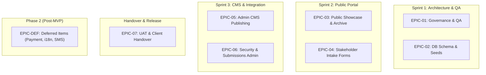

# Product Backlog & Scope Traceability Matrix

**Project:** Web Portal & Content Management System for Lions Club of Balangoda  
**Course:** IS5109 Information Systems Project for Community (Group 14)  
**Client:** Lions Club of Balangoda (Lions Clubs International District 306)  
**Backlog Coordinator:** M.P Asmad Sahee (22FIS0543) | **Facilitator:** M.H.M Yoosuf (22FIS0519)  
**Reviewer:** M.A.J.A Ahnaf (22FIS0569)  
**Scope Baseline:** [MVP Scope Freeze Specification](mvp-scope-specification.md)  
**Status:** **ACTIVE / FROZEN MVP SCOPE** | **Last Updated:** 2026-10-07

---

## 1. Backlog Governance & Structure

Following the Requirements Validation Session with the Lions Club of Balangoda executive officers, this Product Backlog defines the complete set of Epics, User Stories, and Engineering Tasks. 

- All items adhere strictly to the **Definition of Ready (DoR)** before being pulled into a sprint.
- Scope additions resulting from proposal gap resolutions are formally incorporated with dedicated Jira issue keys (`LBW-XX`).
- Deferred items are archived in the **Post-MVP Phase 2 Backlog** to prevent scope creep.

---

## 2. Active Sprint Backlog & MVP Epics

### Epic 1: Team Governance, Architecture & QA Framework (Sprint 1)
*Goal: Establish engineering standards, testing frameworks, and requirements traceability.*

| Issue Key | Type | Summary & User Story | Pts | Req | Assignee | DoR Status |
|---|---|---|---|---|---|---|
| **LBW-01** | Task | **Establish Scrum working agreement:** Publish DoR, DoD, ceremonies, rotating roles matrix, and team calendar. | 3 | NFR-04 | Yoosuf | `DONE` |
| **LBW-02** | Task | **Run requirements validation session with club officers & freeze MVP scope:** Record decisions, data owners, open questions. | 5 | All | Yoosuf / Asmad | `DONE` |
| **LBW-03** | Task | **Establish QA & testing framework:** Test strategy, bug severity policy, standardized test case template. | 5 | NFR-02 | Ahnaf | `DONE` |
| **LBW-04** | Task | **CMS Admin interaction specifications:** Textual screen specs (`SCR-01` to `SCR-20`), admin workflows, confirmation patterns. | 5 | FR-06 | Ahnaf / Jinos | `DONE` |

---

### Epic 2: Relational Database Architecture & Seed Pipeline (Sprint 1)
*Goal: Implement a normalized schema covering all public and administrative use cases.*

| Issue Key | Type | Summary & User Story | Pts | Req | Assignee | DoR Status |
|---|---|---|---|---|---|---|
| **LBW-05** | Story | **Core Relational Schema Migrations:** Author DDL scripts for PostgreSQL and MySQL covering users, projects, board, inquiries, and news. | 8 | SEC-02 | Asmad / Nafris | `DONE` |
| **LBW-06** | Story | **Database Specification & Indexing:** Document entity relationships, cascades, and parameterized query templates. | 5 | NFR-04 | Asmad | `DONE` |
| **LBW-07** | Story | **Seed Data Pipeline:** Seed service pillars, initial admin credentials, impact statistics, and 6 flagship projects. | 3 | FR-01/02 | Asmad | `DONE` |

---

### Epic 3: Public Web Portal & Service Showcases (Sprint 2)
*Goal: Deliver the public-facing portal showcasing club impact, project archives, and board directory.*

| Issue Key | Type | Summary & User Story | Pts | Req | Assignee | DoR Status |
|---|---|---|---|---|---|---|
| **LBW-08** | Story | **Public Homepage Layout:** *As a public visitor, I want to view the club mission, vision, history, and service pillars so that I understand their community impact.* | 5 | FR-01 | Jinos / Zeenath | `READY` |
| **LBW-09** | Story | **Dynamic Homepage Impact Counters:** *As a donor, I want to see verified community impact metrics (beneficiaries, trees, eye camps) on the homepage.* | 3 | FR-01 | Zeenath | `READY` |
| **LBW-10** | Story | **Community Projects List & Filtering:** *As a visitor, I want to search and filter community service initiatives by pillar, keyword, and year.* | 5 | FR-02 | Ahnaf | `READY` |
| **LBW-11** | Story | **Project Detail Narrative & Lightbox Gallery:** *As a visitor, I want to view a full project report with high-resolution lightbox photos.* | 5 | FR-03 | Ahnaf / Jinos | `READY` |
| **LBW-12** | Story | **Executive Board Directory by Term:** *As a visitor, I want to view the club leadership directory filtered by Lionistic year.* | 5 | FR-04 | Asmad / Jinos | `READY` |
| **LBW-13** | Story | **News & Announcements Archive:** *As a community member, I want to read published club news, press releases, and upcoming activity notices.* | 5 | FR-06 | Zeenath | `READY` |
| **LBW-14** | Story | **Global Responsive Navigation & Brand Footer:** *As a mobile user, I want an accessible navigation bar and footer adhering to Lions brand standards.* | 3 | NFR-02 | Jinos | `READY` |

---

### Epic 4: Stakeholder Engagement & Intake Services (Sprint 2)
*Goal: Provide structured, validated web forms with automated notification triggers.*

| Issue Key | Type | Summary & User Story | Pts | Req | Assignee | DoR Status |
|---|---|---|---|---|---|---|
| **LBW-15** | Story | **Volunteer Registration Intake:** *As a community volunteer, I want to submit my skills and availability so that I can participate in upcoming service projects.* | 5 | FR-05 | Yoosuf | `READY` |
| **LBW-16** | Story | **General & Sponsorship Inquiry Form:** *As a donor or partner, I want to submit general inquiries or partnership proposals via a secure web form.* | 3 | FR-05 | Yoosuf | `READY` |
| **LBW-17** | Story | **Automated Transactional Email Alerts:** *As a club secretary and applicant, I want immediate email notifications upon form submission.* | 5 | FR-05 | Nafris | `READY` |

---

### Epic 5: Administrative Content Management System (Sprint 3)
*Goal: Deliver code-free publishing workflows for club officers.*

| Issue Key | Type | Summary & User Story | Pts | Req | Assignee | DoR Status |
|---|---|---|---|---|---|---|
| **LBW-18** | Story | **Admin Authentication & Session Security:** *As a club officer, I want to log in securely with email and password so that I can access administrative tools.* | 5 | SEC-04 | Nafris | `READY` |
| **LBW-19** | Story | **Project Publishing & WYSIWYG Editor:** *As a club editor, I want to draft, preview, edit, and publish project briefs without writing code.* | 8 | FR-06 | Ahnaf / Asmad | `READY` |
| **LBW-20** | Story | **News & Announcements Management:** *As a club secretary, I want to create, pin, and archive news items.* | 5 | FR-06 | Zeenath | `READY` |
| **LBW-21** | Story | **Cloudinary Media Asset Library:** *As an officer, I want to upload, organize, and attach event photos to projects.* | 5 | FR-06 | Nafris | `READY` |
| **LBW-22** | Story | **Board Records & Terms Management:** *As a secretary, I want to update annual board member profiles and designations.* | 5 | FR-06 | Asmad | `READY` |
| **LBW-23** | Story | **Impact Statistics Editor:** *As an admin, I want to update homepage impact counter figures.* | 2 | FR-01 | Jinos | `READY` |

---

### Epic 6: Security, RBAC & Submissions Management (Sprint 3)
*Goal: Safeguard administrative access and streamline volunteer review.*

| Issue Key | Type | Summary & User Story | Pts | Req | Assignee | DoR Status |
|---|---|---|---|---|---|---|
| **LBW-24** | Story | **Submissions Review Dashboard:** *As a secretary, I want to review, filter, and update statuses of volunteer applications and general inquiries.* | 5 | FR-07 | Yoosuf | `READY` |
| **LBW-25** | Story | **CSV Data Export Utility:** *As an officer, I want to export received volunteer signups to a CSV file for offline field coordination.* | 3 | FR-07 | Yoosuf | `READY` |
| **LBW-26** | Story | **Role-Based Access Control (RBAC):** *As an admin, I want to restrict user management to Super Admins while allowing Editors to update content.* | 5 | SEC-04 | Nafris | `READY` |
| **LBW-27** | Story | **Deletion Safeguards & Unpublish Pattern:** *As an editor, I want confirmation dialogs distinguishing irreversible deletion from safe unpublishing.* | 3 | FR-06 | Jinos | `READY` |

---

### Epic 7: Production Readiness, UAT & Handover (Handover Week)
*Goal: Guarantee zero defects, conduct client training, and deploy to live domain.*

| Issue Key | Type | Summary & User Story | Pts | Req | Assignee | DoR Status |
|---|---|---|---|---|---|---|
| **LBW-28** | Task | **Production Cloud Deployment & SSL Setup:** Configure custom domain DNS and HTTPS certificates. | 3 | SEC-01 | Nafris / Zeenath | `BACKLOG` |
| **LBW-29** | Task | **Performance & Accessibility Audit:** Verify < 2.5s LCP on 4G and WCAG 2.1 AA compliance. | 3 | NFR-01/02 | Ahnaf | `BACKLOG` |
| **LBW-30** | Task | **Deliver Administrative Operations Manual:** Complete printed and digital CMS user manual. | 5 | NFR-04 | Zeenath | `BACKLOG` |
| **LBW-31** | Task | **Officer Training & Formal Handover:** Conduct in-person onboarding session with Balangoda Lions officers. | 3 | All | All Members | `BACKLOG` |

---

## 3. Explicit Backlog Adjustments from Proposal Review

| Refinement | Affected Requirement | Jira Story Added / Modified | Description of Scope Change |
|---|---|---|---|
| **News Entity Addition** | FR-06 | `LBW-13`, `LBW-20` | Resolves Proposal Gap #2: Added full News & Announcements publishing to match class diagram. |
| **Separate Intake Forms** | FR-05, FR-07 | `LBW-15`, `LBW-16`, `LBW-24` | Resolves Proposal Gap #3: Split generic `INQUIRY_VOLUNTEER` into dedicated Volunteer Applications and Inquiries. |
| **Dynamic Impact Counters** | FR-01 | `LBW-09`, `LBW-23` | Resolves Proposal Gap #8: Added editable impact counter storage and admin management. |
| **CSV Submissions Export** | FR-07 | `LBW-25` | Resolves Proposal Gap #10: Formalized CSV export specification for volunteer rosters. |
| **Transactional Email Integration** | FR-05 | `LBW-17` | Resolves Proposal Gap #7: Automated email dispatch configured via Resend / SMTP. |

---

## 4. Post-MVP Phase 2 Backlog (Deferred Scope)

These stories are formally preserved for subsequent development cycles following initial release:

| Issue Key | Epic / Feature | Description | Deferral Rationale |
|---|---|---|---|
| **LBW-DEF-01** | Direct Payment Gateway | Online credit/debit card processing for donations. | High compliance cost and complex banking merchant setup outside student timeline. |
| **LBW-DEF-02** | Multi-Language Localization | Full Sinhala and Tamil translations for dynamic CMS articles. | Content management overhead; deferred pending bilingual club editor training. |
| **LBW-DEF-03** | Public Discussion Forum | Commenting and community feedback under project briefs. | Requires full-time moderation to prevent spam and reputational risk. |
| **LBW-DEF-04** | SMS Notification Gateway | Automated SMS broadcast for urgent community alerts. | Recurring operational SMS costs; substituted with free email alerts in MVP. |
