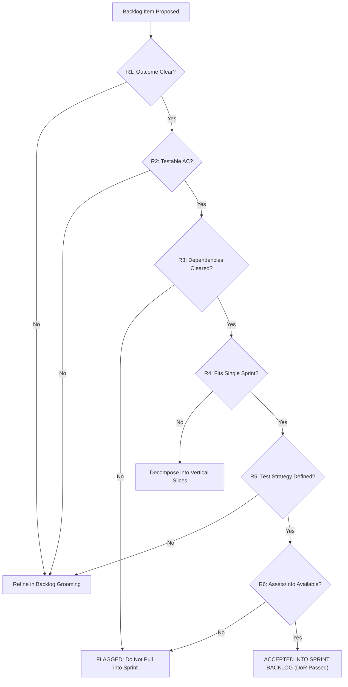
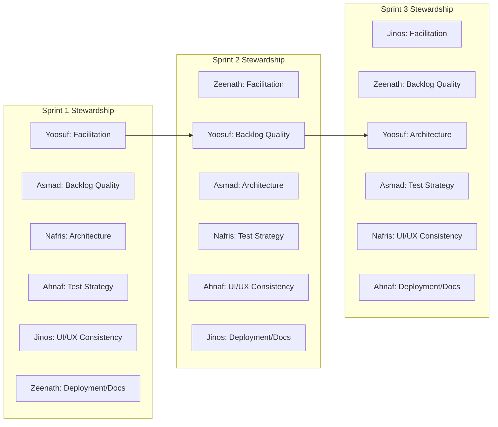

# Scrum Working Agreement, Team Governance & Quality Standards

**Course:** IS5109 – Information Systems Project for Community  
**Project:** Web Portal & Content Management System for Lions Club of Balangoda  
**Group:** Group 14 (Faculty of Computing, Sabaragamuwa University of Sri Lanka)  
**Client:** Lions Club of Balangoda (Lions Clubs International District 306)  
**Priority:** Highest | **Task:** Establish Scrum Working Agreement  
**Author:** M.H.M Yoosuf (22FIS0519) — Branch: `yoosuf/scrum-working-agreement`  
**Reviewer:** M.A.J.A Ahnaf (22FIS0569)  
**Status:** **APPROVED & ACKNOWLEDGED BY ALL SIX MEMBERS**  
**Effective Date:** 2026-10-05 | **Revision:** 1.0 (Production Master)

---

## 1. Purpose and Guiding Philosophy

This document represents the binding, pinned Scrum Working Agreement for Group 14. Its purpose is to guarantee predictable velocity, high engineering rigor, zero defect leakage, and psychological safety across all sprints of the Lions Club of Balangoda portal project.

### 1.1 Fundamental Team Practices
1. **Implementation by All Members:** Every single team member writes code, implements features, and authors automated/manual tests every sprint. There are no passive observers or administrative-only roles.
2. **Primary Owner + Collaborating Reviewer:** Every significant story, database schema, or architectural component has one Primary Author and one assigned Collaborating Reviewer. The reviewer must review the work before it can be merged.
3. **Pairing and Mob Programming Sessions:** Complex architectural decisions, authentication mechanisms, database migration rollbacks, and mission-critical API integrations will be implemented via scheduled pairing or mob programming sessions to ensure shared context.
4. **Anti-Silo Rule:** There are **strictly no permanent silos** (e.g., no exclusive "frontend guy", "database guy", "QA person", or "documentation writer"). Members rotate coordination responsibilities and contribute across the full stack.

---

## 2. Definition of Ready (DoR)

The **Definition of Ready (DoR)** is the formal gatekeeper for the Sprint Backlog. A user story or backlog item enters a sprint **only** when all the following preconditions are met. **Blocked work is strictly barred from entering a sprint.**

### 2.1 Universal DoR Checklist

Every user story must satisfy all six entry criteria prior to Sprint Planning sign-off:

| # | Criterion | Verification Standard |
|---|---|---|
| **R1** | **Clear Objective & User Outcome** | Written in standard persona format: `As a [persona], I want [action] so that [business value / outcome]`. The motivation and intended user benefit must be explicitly articulated. |
| **R2** | **Testable Acceptance Criteria** | Specified using Gherkin format (`Given... When... Then...`) or an unambiguous, bulleted list of testable conditions. Subjective phrases (e.g., "fast", "intuitive", "clean") are forbidden unless bound to objective metrics (e.g., "loads in < 2.5s on 4G"). |
| **R3** | **Dependencies Identified & Cleared** | All technical, schema, endpoint, or external asset dependencies are identified. If an external dependency exists, a verified resolution path or fallback must be active before sprint entry. |
| **R4** | **Sprint-Sized Scope** | The story is sized to complete within a single sprint with contingency buffer (maximum 5 to 8 story points). Stories larger than 8 points must be decomposed into smaller vertical slices. |
| **R5** | **Testing Strategy Defined** | The testing approach (unit tests, API test cases, manual verification script) is defined, and the assigned QA reviewer is identified. |
| **R6** | **External Information & Assets Ready** | All required client assets (content copy, photography, Lions District 306 brand assets, third-party API credentials, or approvals) are present or scheduled with a zero-risk resolution plan. |



---

## 3. Definition of Done (DoD)

The **Definition of Done (DoD)** provides an unyielding quality contract. No story, task, or bug fix may be marked **Done** in Jira or merged into `main` unless every applicable item on the DoD checklist is completed.

### 3.1 Feature & Sprint Backlog DoD Checklist

For every user story, feature slice, and bug fix across all sprints:

- [ ] **Acceptance Criteria Met:** 100% of the acceptance criteria defined in the story are demonstrably satisfied.
- [ ] **Committed & Pushed to Shared Repo:** Code is committed using standardized commit conventions (`type(scope): message [LBW-XX]`) on the member's dedicated branch and pushed to remote GitHub.
- [ ] **Independent Peer Review:** Code inspected and approved by a collaborating reviewer who did not author the code. Self-approval is strictly forbidden. All review discussion threads must be resolved.
- [ ] **Automated Tests Passing:** All unit and integration test suites pass locally and in CI without failures or skipped assertions.
- [ ] **Integration & Regression Checks Pass:** Changes integrate cleanly with existing branches and do not break existing public or administrative workflows.
- [ ] **Security & Authorization Verified:**
  - Form inputs sanitized against Cross-Site Scripting (XSS).
  - Database queries strictly parameterized to eliminate SQL injection.
  - Role-Based Access Control (RBAC) enforced on protected admin endpoints (Admin vs. Editor vs. Public Visitor).
  - Sensitive secrets kept out of VCS; referenced exclusively via `.env.local`.
- [ ] **Architectural Alignment:** Follows Next.js 16 App Router standards, TypeScript strict mode, and modular MVC layering (`Controller` → `Service` → `Repository` → `Database`).
- [ ] **Documentation Updated:** Code includes TSDoc comments for public functions; project documentation, API contracts, or schema notes updated accordingly.
- [ ] **Zero Release-Blocking Defects:** No unresolved Critical (P1) or High (P2) defects against the changed code.
- [ ] **Live Demonstration / Verification:** Feature demonstrated and verified in a working environment or local build (`npm run build`).
- [ ] **Jira Workflow Transition:** Transitioned to `Done` only after all DoD checklist items have been validated.

### 3.2 Production & Handover DoD Checklist

In addition to Section 3.1, deliverables in Sprint 3 and final handover must fulfill:

- [ ] **Deployment Verification:** Successfully deployed to production hosting with HTTPS/TLS certificates active.
- [ ] **Performance SLA Met:** Landing page First Contentful Paint (FCP) and Largest Contentful Paint (LCP) under 2.5 seconds on 4G networks (NFR-01).
- [ ] **Accessibility Compliance:** WCAG 2.1 Level AA accessibility validation passed with zero high-contrast or screen-reader blockers (NFR-02).
- [ ] **Client Acceptance Sign-Off:** Formal review and sign-off by the Lions Club of Balangoda President (Lion Prof. T. Sanjeewa Prasad Jayaweera) and Project Committee.
- [ ] **Documentation Delivery:** Administrative Operations Manual and CMS User Guide delivered to club officers.
- [ ] **Training Conducted:** Hands-on onboarding session conducted for non-technical club editors.
- [ ] **Disaster Recovery & Backup:** Weekly automated database backup scheduled and verified.


---

## 4. Rotating Coordination Roles (Sprints 1–3)

Coordination roles rotate every sprint to prevent leadership fatigue, eliminate hierarchical barriers, and promote cross-functional mastery. 

> [!IMPORTANT]
> **Coordination Roles Are NOT Implementation Silos:**
> Holding a coordination role does **not** exempt a member from core engineering. Every team member implements features, authors database/API code, and writes automated tests every sprint. Coordinators steward quality standards and unblock peers.

### 4.1 Rotating Coordination Matrix

| Coordination Role | Sprint 1 | Sprint 2 | Sprint 3 |
|---|---|---|---|
| **Sprint Facilitation & Stakeholder Coordination** | **Yoosuf** (22FIS0519) | **Zeenath** (22FIS0593) | **Jinos** (22FIS0572) |
| **Backlog Quality & Requirements Traceability** | **Asmad** (22FIS0543) | **Yoosuf** (22FIS0519) | **Zeenath** (22FIS0593) |
| **Technical Architecture & Integration** | **Nafris** (22FIS0545) | **Asmad** (22FIS0543) | **Yoosuf** (22FIS0519) |
| **Testing Strategy & Acceptance Criteria** | **Ahnaf** (22FIS0569) | **Nafris** (22FIS0545) | **Asmad** (22FIS0543) |
| **UI/UX Consistency & Usability Review** | **Jinos** (22FIS0572) | **Ahnaf** (22FIS0569) | **Nafris** (22FIS0545) |
| **Deployment Readiness & Documentation** | **Zeenath** (22FIS0593) | **Jinos** (22FIS0572) | **Ahnaf** (22FIS0569) |



### 4.2 Responsibilities of Each Coordination Role

1. **Sprint Facilitation & Stakeholder Coordination:**
   - Facilitates Daily Standups (strictly 15 minutes), Sprint Planning, Sprint Review, and Retrospectives.
   - Shields the development team from external scope churn; maintains active liaison with Supervisor (Mr. K.P.D.P. Patabandi) and Client (Lion Prof. T. Sanjeewa Prasad Jayaweera).
   - Identifies and tracks impediment removal; ensures team velocity is measured.

2. **Backlog Quality & Requirements Traceability:**
   - Enforces the Definition of Ready (DoR); verifies that incoming Jira issues carry testable acceptance criteria and correct `LBW-XX` issue tags.
   - Maintains the Requirements Traceability Matrix (RTM) linking FR-01 through FR-07 to user stories and database entities.
   - Flags orphaned backlog items or scope drift during refinement sessions.

3. **Technical Architecture & Integration:**
   - Stewards the technical alignment across Next.js 16 App Router, TypeScript contracts, database migrations, and Cloudinary CDN configurations.
   - Monitors PR merges for branch divergence, migration collisions, or violations of MVC layering.
   - Coordinates pairing/mobbing sessions for complex full-stack vertical slices.

4. **Testing Strategy & Acceptance Criteria:**
   - Enforces the Quality Assurance strategy (`Docs/QA/test-strategy.md`) and bug severity gates (`Docs/QA/bug-severity-scale.md`).
   - Ensures that automated unit/integration tests accompany new feature PRs and that regressions are prevented.
   - Audits PR test coverage and verifies compliance with acceptance criteria before merge approval.

5. **UI/UX Consistency & Usability Review:**
   - Ensures visual fidelity to Lions Clubs International brand guidelines (official gold and blue palette, typography, responsive breakpoints).
   - Verifies responsive layout integrity from mobile (360px) to desktop (1920px) and WCAG 2.1 AA color contrast compliance.
   - Audits non-technical administrative screens to guarantee user-friendly error messages and confirmation patterns.

6. **Deployment Readiness & Documentation:**
   - Verifies environment configurations (`.env.example` vs `.env.local`), build success (`npm run build`), and deployment pipeline health.
   - Stewards documentation accuracy across `Docs/`, API contracts, and user guides.
   - Oversees database backup verifications and security hygiene (e.g., zero secrets committed to VCS).


---

## 5. Scrum Ceremonies & Protocol

All ceremonies are strictly timeboxed and mandatory for all six team members.

### 5.1 Ceremony Definitions & Structure

```
                    ┌────────────────────────────────────────┐
                    │       Sprint Planning (2h, Day 1)      │
                    └───────────────────┬────────────────────┘
                                        │
                                        ▼
      ┌──────────────────────────────────────────────────────────────────┐
      │  Daily Scrum (15m, M-F 08:30) & Weekly Refinement (1h, Wed 17:00) │
      └─────────────────────────────────┬────────────────────────────────┘
                                        │
                    ┌───────────────────┴────────────────────┐
                    ▼                                        ▼
┌──────────────────────────────────────┐ ┌──────────────────────────────────────┐
│     Sprint Review (1.5h, Final Day)  │ │   Sprint Retrospective (1h, Final Day)│
│       Demonstration & Validation     │ │        Continuous Improvement        │
└──────────────────────────────────────┘ └──────────────────────────────────────┘
```

1. **Sprint Planning:**
   - **Timing:** First Monday of each sprint (09:00 AM – 11:00 AM).
   - **Facilitator:** Rotating Sprint Facilitator.
   - **Inputs:** Prioritized Product Backlog, completed DoR checklists, team capacity.
   - **Outputs:** Agreed Sprint Goal and committed Sprint Backlog in Jira.

2. **Daily Scrum (Standup):**
   - **Timing:** Monday through Friday at 08:30 AM – 08:45 AM (Strict 15-minute timebox).
   - **Platform:** Discord / Google Meet voice channel.
   - **Agenda:** Each member answers three standard questions:
     1. *What did I accomplish yesterday that unblocked the sprint goal?*
     2. *What will I implement today to advance the sprint backlog?*
     3. *Are there any blockers, architectural ambiguities, or dependencies impeding my work?*
   - Any discussion requiring more than 2 minutes is parked for a post-standup breakout topic.

3. **Backlog Refinement (Grooming):**
   - **Timing:** Mid-sprint every Wednesday at 05:00 PM – 06:00 PM (1 hour).
   - **Facilitator:** Rotating Backlog Quality Coordinator.
   - **Agenda:** Review candidate stories for upcoming sprints, decompose stories exceeding 8 points, verify DoR readiness, and validate technical dependencies.

4. **Sprint Review (Demo & Stakeholder Inspection):**
   - **Timing:** Final Friday of each sprint at 02:00 PM – 03:30 PM (1.5 hours).
   - **Attendees:** All six team members, Internal Supervisor (Mr. K.P.D.P. Patabandi), and Client Representatives (Lions Club of Balangoda).
   - **Agenda:** Live demonstration of completed, working vertical slices on staging; verification against DoD; gathering client and supervisor feedback.

5. **Sprint Retrospective:**
   - **Timing:** Final Friday of each sprint at 04:00 PM – 05:00 PM (1 hour, following Review).
   - **Attendees:** Internal team members only.
   - **Agenda:** Structured review using "Start, Stop, Continue"; analysis of velocity metrics and escaped defects; assignment of 1–3 concrete process improvement action items for the next sprint.

---

## 6. Official Team Calendar (Sprints 1–3)

This calendar establishes the unalterable dates for all formal milestone reviews and retrospectives across the project lifecycle.

### 6.1 Sprint Dates Overview

| Sprint | Phase Focus | Start Date | End Date | Duration |
|---|---|---|---|---|
| **Sprint 1** | Inception, DB Architecture, QA Strategy & CMS Specs | Monday, Oct 05, 2026 | Friday, Oct 23, 2026 | 3 Weeks |
| **Sprint 2** | Core Architecture, Public Portal & Data Services | Monday, Oct 26, 2026 | Friday, Nov 13, 2026 | 3 Weeks |
| **Sprint 3** | Admin CMS Implementation, End-to-End Integration & UAT | Monday, Nov 16, 2026 | Friday, Dec 04, 2026 | 3 Weeks |
| **Handover** | Production Deployment, Client Training & Final Sign-off | Monday, Dec 07, 2026 | Friday, Dec 11, 2026 | 1 Week |

### 6.2 Key Ceremony Schedule: Sprint Review & Retrospective Dates

> [!IMPORTANT]
> The table below records the confirmed team calendar milestone dates. All members and stakeholders are synchronized with these calendar events:

| Sprint | Event | Date | Time | Location / Channel | Lead Facilitator |
|---|---|---|---|---|---|
| **Sprint 1** | Sprint 1 Planning | Mon, Oct 05, 2026 | 09:00 – 11:00 AM | Lab 02 / Google Meet | Yoosuf |
| **Sprint 1** | Backlog Refinement 1 | Wed, Oct 14, 2026 | 05:00 – 06:00 PM | Discord Stage | Asmad |
| **Sprint 1** | Backlog Refinement 2 | Wed, Oct 21, 2026 | 05:00 – 06:00 PM | Discord Stage | Asmad |
| **Sprint 1** | **Sprint 1 Review (Demo)** | **Fri, Oct 23, 2026** | **02:00 – 03:30 PM** | **Faculty Boardroom / Meet** | **Yoosuf** |
| **Sprint 1** | **Sprint 1 Retrospective** | **Fri, Oct 23, 2026** | **04:00 – 05:00 PM** | **Discord Private Room** | **Yoosuf** |
| | | | | | |
| **Sprint 2** | Sprint 2 Planning | Mon, Oct 26, 2026 | 09:00 – 11:00 AM | Lab 02 / Google Meet | Zeenath |
| **Sprint 2** | Backlog Refinement 1 | Wed, Nov 04, 2026 | 05:00 – 06:00 PM | Discord Stage | Yoosuf |
| **Sprint 2** | Backlog Refinement 2 | Wed, Nov 11, 2026 | 05:00 – 06:00 PM | Discord Stage | Yoosuf |
| **Sprint 2** | **Sprint 2 Review (Demo)** | **Fri, Nov 13, 2026** | **02:00 – 03:30 PM** | **Faculty Boardroom / Meet** | **Zeenath** |
| **Sprint 2** | **Sprint 2 Retrospective** | **Fri, Nov 13, 2026** | **04:00 – 05:00 PM** | **Discord Private Room** | **Zeenath** |
| | | | | | |
| **Sprint 3** | Sprint 3 Planning | Mon, Nov 16, 2026 | 09:00 – 11:00 AM | Lab 02 / Google Meet | Jinos |
| **Sprint 3** | Backlog Refinement 1 | Wed, Nov 25, 2026 | 05:00 – 06:00 PM | Discord Stage | Zeenath |
| **Sprint 3** | Backlog Refinement 2 | Wed, Dec 02, 2026 | 05:00 – 06:00 PM | Discord Stage | Zeenath |
| **Sprint 3** | **Sprint 3 Review (Demo)** | **Fri, Dec 04, 2026** | **02:00 – 03:30 PM** | **Balangoda Lions Club / Meet** | **Jinos** |
| **Sprint 3** | **Sprint 3 Retrospective** | **Fri, Dec 04, 2026** | **04:00 – 05:00 PM** | **Discord Private Room** | **Jinos** |
| | | | | | |
| **Handover** | Client Onboarding & Admin Training | Wed, Dec 09, 2026 | 10:00 – 12:30 PM | Balangoda Lions Secretariat | All Members |
| **Handover** | Final Project Presentation & Sign-off | Fri, Dec 11, 2026 | 02:00 – 04:00 PM | SUSL Faculty of Computing | All Members |
